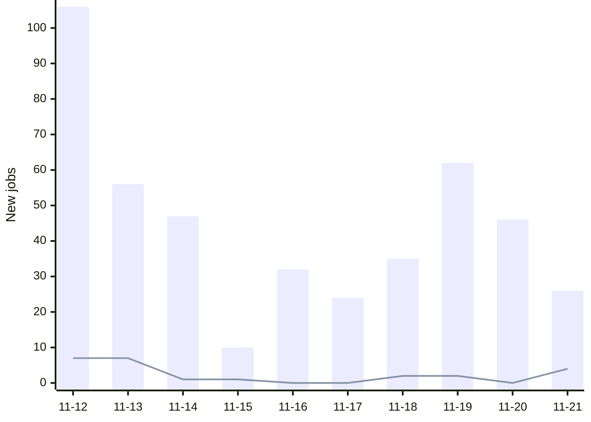

# Remote Software Job Tracker

Tracks remote **software development** jobs every day, sorts them by role (frontend, backend,
full-stack, mobile and more), and flags the ones open to candidates in Kenya. A GitHub Actions workflow runs a Python script on a schedule, fetches listings
from the [Remotive](https://remotive.com) and [Jobicy](https://jobicy.com) public APIs, deduplicates them, and commits the updated data.

**Live site:** https://mwangimark.github.io/frontend-job-tracker/ (Angular app in `site/`, redeployed after every update)

**Last updated:** 2026-11-21 · **Jobs tracked:** 444 · **Open to Kenya:** 24 ·
**New today:** 26 (4 open to Kenya)

**By role:** General Software: 118 · Data & AI: 59 · Full-stack: 45 · Solutions & Integrations: 44 · QA & Testing: 39 · Backend: 36 · Engineering Leadership: 35 · Frontend: 18 · Mobile: 18 · DevOps & Cloud: 17 · Embedded & Systems: 15

## New jobs per day (last 30 days)

Bars: all new jobs. Line: new jobs open to Kenya.

## Latest 20 jobs

| Published | Job | Role | Company | Location | Open to Kenya |
|---|---|---|---|---|---|
| 2026-11-21 | [Senior Web Engineer - Subscriptions](https://jobicy.com/jobs/156186-senior-web-engineer-subscriptions) | Frontend | Spotify | EMEA | ✅ |
| 2026-11-21 | [Engineering Manager](https://jobicy.com/jobs/156122-engineering-manager-10) | Engineering Leadership | Monzo | UK |  |
| 2026-11-21 | [Contract Staff Software Engineer-Bug Burndown](https://jobicy.com/jobs/156172-contract-staff-software-engineer-bug-burndown) | General Software | Mozilla | Germany |  |
| 2026-11-21 | [Contract Staff Software Engineer - (Firefox) C++,Storage Encryption](https://jobicy.com/jobs/156176-contract-staff-software-engineer-firefox-cstorage-encryption) | General Software | Mozilla | Canada,  Germany,  UK |  |
| 2026-11-21 | [Software Engineer (.NET)](https://jobicy.com/jobs/156146-software-engineer-net) | Backend | LastPass | Portugal |  |
| 2026-11-21 | [Applied AI Engineer](https://jobicy.com/jobs/156098-applied-ai-engineer-2) | Data & AI | Future PLC | USA |  |
| 2026-11-21 | [Manager, Software Engineering, Operations](https://jobicy.com/jobs/153629-manager-software-engineering-operations) | General Software | Jobber | Canada,  USA |  |
| 2026-11-21 | [Staff Software Engineer - Market Data](https://jobicy.com/jobs/156140-staff-software-engineer-market-data) | Data & AI | Dune | Europe,  USA |  |
| 2026-11-21 | [Manager, Machine Learning Engineering](https://jobicy.com/jobs/156097-manager-machine-learning-engineering) | Data & AI | Tala | USA |  |
| 2026-11-21 | [Finnish Tech Linguistic Tester](https://jobicy.com/jobs/146757-finnish-tech-linguistic-tester) | QA & Testing | Welo Global | Anywhere | ✅ |
| 2026-11-21 | [Senior UICC/eUICC/eSIM Engineer](https://jobicy.com/jobs/151131-senior-uicc-euicc-esim-engineer) | General Software | emnify | Austria,  Germany,  Poland,  Switzerland |  |
| 2026-11-21 | [Software Engineer - Secure Container Images](https://jobicy.com/jobs/150994-software-engineer-secure-container-images) | General Software | Canonical | Anywhere | ✅ |
| 2026-11-21 | [Distributed Systems Testing Software Engineer, Python / Go](https://jobicy.com/jobs/151013-distributed-systems-testing-software-engineer-python-go) | QA & Testing | Canonical | Anywhere | ✅ |
| 2026-11-21 | [Senior Fullstack Engineer](https://jobicy.com/jobs/151178-senior-fullstack-engineer-2) | Full-stack | Dispatch | USA |  |
| 2026-11-21 | [Backend Software Engineer](https://jobicy.com/jobs/150975-backend-software-engineer-2) | Backend | Northflank | Europe |  |
| 2026-11-20 | [AI Experience Engineer (Conversational AI)](https://jobicy.com/jobs/163598-ai-experience-engineer-conversational-ai) | Data & AI | Upgrade | Canada |  |
| 2026-11-20 | [Alpheratz Project - Valencia (Spain) Translation Quality Rater](https://jobicy.com/jobs/163593-alpheratz-project-valencia-spain-translation-quality-rater) | QA & Testing | Welo Global | Spain |  |
| 2026-11-20 | [Alpheratz Project - Polish (Poland) Translation Quality Rater](https://jobicy.com/jobs/163591-alpheratz-project-polish-poland-translation-quality-rater) | QA & Testing | Welo Global | Poland |  |
| 2026-11-20 | [Ads Quality Rater - Lithuanian (Lithuania)](https://jobicy.com/jobs/163588-ads-quality-rater-lithuanian-lithuania-2) | QA & Testing | Welo Global | Lithuania |  |
| 2026-11-20 | [Software Engineer (Go)](https://jobicy.com/jobs/163586-software-engineer-go-2) | General Software | Paddle | Ireland,  Portugal,  UK |  |

## How it works

- `.github/workflows/track-jobs.yml` runs daily at 08:17 EAT (and on demand).
- `scripts/track_jobs.py` fetches the software development category, classifies each job's role from its title, merges new jobs into
  `data/jobs.csv`, appends a row to `data/daily_stats.csv`, and regenerates this README.
- Only Python's standard library is used, so the workflow needs no dependencies.
- `.github/workflows/deploy-site.yml` rebuilds the Angular site in `site/` with the new data
  and deploys it to GitHub Pages.
- `scripts/send_alerts.py` emails subscribers their matching new jobs (daily, or weekly on Mondays).
  Subscribers are stored in Supabase (`supabase/schema.sql`); emails go out through Gmail SMTP.

Job data comes from [Remotive](https://remotive.com) and [Jobicy](https://jobicy.com); each link goes to the original listing.
