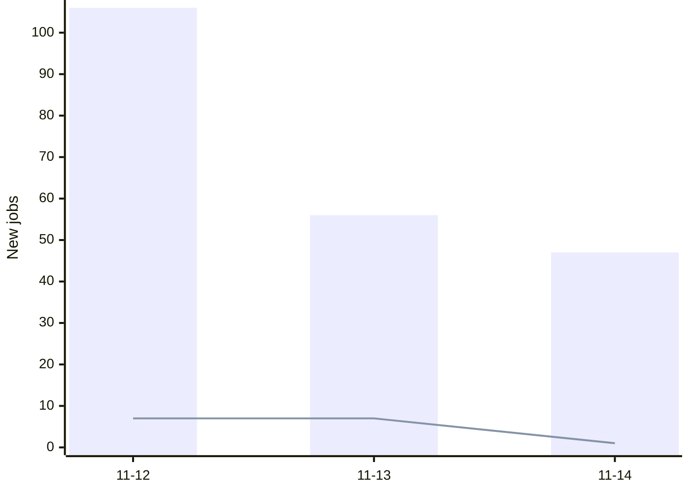

# Remote Software Job Tracker

Tracks remote **software development** jobs every day, sorts them by role (frontend, backend,
full-stack, mobile and more), and flags the ones open to candidates in Kenya. A GitHub Actions workflow runs a Python script on a schedule, fetches listings
from the [Remotive](https://remotive.com) and [Jobicy](https://jobicy.com) public APIs, deduplicates them, and commits the updated data.

**Live site:** https://mwangimark.github.io/frontend-job-tracker/ (Angular app in `site/`, redeployed after every update)

**Last updated:** 2026-11-14 · **Jobs tracked:** 209 · **Open to Kenya:** 15 ·
**New today:** 47 (1 open to Kenya)

**By role:** General Software: 48 · Data & AI: 34 · Full-stack: 22 · Solutions & Integrations: 22 · Engineering Leadership: 19 · Backend: 18 · Frontend: 11 · Embedded & Systems: 11 · QA & Testing: 10 · DevOps & Cloud: 9 · Mobile: 5

## New jobs per day (last 30 days)

Bars: all new jobs. Line: new jobs open to Kenya.

## Latest 20 jobs

| Published | Job | Role | Company | Location | Open to Kenya |
|---|---|---|---|---|---|
| 2026-11-14 | [Senior Software Engineer, Frontend / Product Engineering](https://jobicy.com/jobs/162134-senior-software-engineer-frontend-product-engineering) | Frontend | TRM Labs | USA |  |
| 2026-11-14 | [Senior GTM Systems Engineer](https://jobicy.com/jobs/162127-senior-gtm-systems-engineer) | Solutions & Integrations | Apollo.io | USA |  |
| 2026-11-14 | [Senior Engineer, Server – NBA 2K](https://jobicy.com/jobs/162125-senior-engineer-server-nba-2k) | General Software | Visual Concepts | USA |  |
| 2026-11-14 | [Principal + Staff Software Engineers](https://jobicy.com/jobs/162122-principal-staff-software-engineers) | General Software | Unstructured Technologies Inc. | USA |  |
| 2026-11-14 | [Graphics Engineer - NBA 2K](https://jobicy.com/jobs/162121-graphics-engineer-nba-2k) | General Software | Visual Concepts | USA |  |
| 2026-11-14 | [Project Sceptrum - Multilingual AI Coding Evaluation Specialist - Dutch](https://jobicy.com/jobs/162115-project-sceptrum-multilingual-ai-coding-evaluation-specialist-dutch) | Data & AI | Welo Global | Netherlands |  |
| 2026-11-14 | [Senior Full Stack Engineer - Databases - Analytics / UK / Remote](https://jobicy.com/jobs/162114-senior-full-stack-engineer-databases-analytics-uk-remote) | Full-stack | Grafana Labs | Germany,  Ireland,  Spain,  Sweden,  UK |  |
| 2026-11-14 | [Senior Full Stack Engineer - Databases - Analytics / Sweden / Remote](https://jobicy.com/jobs/162112-senior-full-stack-engineer-databases-analytics-sweden-remote) | Full-stack | Grafana Labs | Germany,  Ireland,  Spain,  Sweden,  UK |  |
| 2026-11-14 | [Senior Full Stack Engineer - Databases, Analytics / Spain / Remote](https://jobicy.com/jobs/162108-senior-full-stack-engineer-databases-analytics-spain-remote) | Full-stack | Grafana Labs | Germany,  Ireland,  Spain,  Sweden,  UK |  |
| 2026-11-14 | [Senior Full Stack Engineer - Databases - Analytics / Ireland / Remote](https://jobicy.com/jobs/162104-senior-full-stack-engineer-databases-analytics-ireland-remote) | Full-stack | Grafana Labs | Germany,  Ireland,  Spain,  Sweden,  UK |  |
| 2026-11-14 | [Senior Full Stack Engineer - Databases - Analytics / Germany / Remote](https://jobicy.com/jobs/162101-senior-full-stack-engineer-databases-analytics-germany-remote) | Full-stack | Grafana Labs | Germany,  Ireland,  Spain,  Sweden,  UK |  |
| 2026-11-14 | [Product Engineer (all levels)](https://jobicy.com/jobs/162100-product-engineer-all-levels) | General Software | Anima | UK |  |
| 2026-11-14 | [Technical Lead - Golang](https://jobicy.com/jobs/162099-technical-lead-golang) | Backend | Nearform | UK |  |
| 2026-11-14 | [Machine Learning Engineering Manager II](https://jobicy.com/jobs/162092-machine-learning-engineering-manager-ii) | Engineering Leadership | Spotify | Sweden,  UK |  |
| 2026-11-14 | [Engineering Manager, Ads Product Catalogs](https://jobicy.com/jobs/162091-engineering-manager-ads-product-catalogs) | Engineering Leadership | Reddit | Netherlands,  UK |  |
| 2026-11-14 | [Senior Staff Engineer - Mobile/Kotlin](https://jobicy.com/jobs/155305-senior-staff-engineer-mobile-kotlin) | Mobile | Fanatics | USA |  |
| 2026-11-14 | [Ai Solution Engineer - (Technology Support)](https://jobicy.com/jobs/155288-ai-solution-engineer-technology-support) | Data & AI | PointClickCare | Canada |  |
| 2026-11-14 | [Senior Software Engineer](https://jobicy.com/jobs/155311-senior-software-engineer-14) | General Software | RStudio | USA |  |
| 2026-11-14 | [Senior Software Engineer, Observability](https://jobicy.com/jobs/155325-senior-software-engineer-observability) | General Software | NetBox Labs | LATAM,  USA |  |
| 2026-11-14 | [Senior Staff Software Engineer, Partner Integrations](https://jobicy.com/jobs/155313-senior-staff-software-engineer-partner-integrations) | Solutions & Integrations | Flex | Anywhere | ✅ |

## How it works

- `.github/workflows/track-jobs.yml` runs daily at 08:17 EAT (and on demand).
- `scripts/track_jobs.py` fetches the software development category, classifies each job's role from its title, merges new jobs into
  `data/jobs.csv`, appends a row to `data/daily_stats.csv`, and regenerates this README.
- Only Python's standard library is used, so the workflow needs no dependencies.
- `.github/workflows/deploy-site.yml` rebuilds the Angular site in `site/` with the new data
  and deploys it to GitHub Pages.

Job data comes from [Remotive](https://remotive.com) and [Jobicy](https://jobicy.com); each link goes to the original listing.
