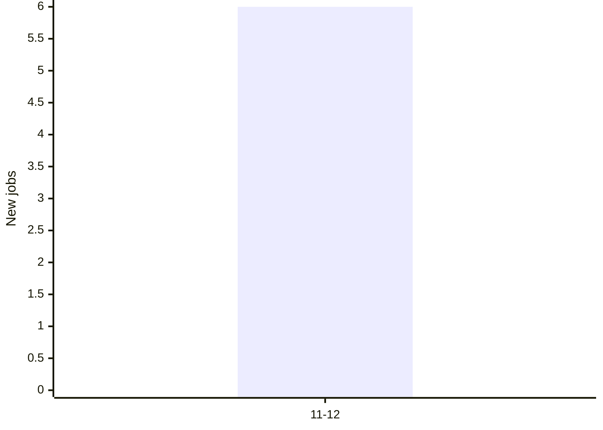

# Remote Software Job Tracker

Tracks remote **software development** jobs every day, sorts them by role (frontend, backend,
full-stack, mobile and more), and flags the ones open to candidates in Kenya. A GitHub Actions workflow runs a Python script on a schedule, fetches listings
from the [Remotive](https://remotive.com) public API, deduplicates them, and commits the updated data.

**Live site:** https://mwangimark.github.io/frontend-job-tracker/ (Angular app in `site/`, redeployed after every update)

**Last updated:** 2026-11-12 · **Jobs tracked:** 6 · **Open to Kenya:** 3 ·
**New today:** 6 (3 open to Kenya)

**By role:** Full-stack: 3 · Backend: 1 · Data & AI: 1 · General: 1

## New jobs per day (last 30 days)

Bars: all new jobs. Line: new jobs open to Kenya.

## Latest 20 jobs

| Published | Job | Role | Company | Location | Open to Kenya |
|---|---|---|---|---|---|
| 2026-11-10 | [Senior React Full-stack Developer](https://remotive.com/remote-jobs/software-development/senior-react-full-stack-developer-2091136) | Full-stack | Lemon.io | LATAM, Europe, USA, Canada, APAC |  |
| 2026-10-29 | [Full-Stack Developer](https://remotive.com/remote-jobs/software-development/full-stack-developer-2091165) | Full-stack | Fluence International, Inc. | Worldwide | ✅ |
| 2026-10-27 | [Senior Back-end Developer](https://remotive.com/remote-jobs/software-development/senior-back-end-developer-2091135) | Backend | Lemon.io | Europe, USA, Canada, Australia, Singapore, Mexico, Saudi Arabia |  |
| 2026-10-26 | [Head of Engineering](https://remotive.com/remote-jobs/software-development/head-of-engineering-2091134) | General | Lemon.io | Worldwide | ✅ |
| 2026-10-17 | [Software Engineer, AI Coding Tasks](https://remotive.com/remote-jobs/software-development/software-engineer-ai-coding-tasks-2091158) | Data & AI | Askable | Worldwide | ✅ |
| 2026-10-14 | [Tech Lead Full-Stack Rails Engineer](https://remotive.com/remote-jobs/software-development/tech-lead-full-stack-rails-engineer-2069746) | Full-stack | Mitre Media | USA, Canada, USA timezones |  |

## How it works

- `.github/workflows/track-jobs.yml` runs daily at 08:17 EAT (and on demand).
- `scripts/track_jobs.py` fetches the software development category, classifies each job's role from its title, merges new jobs into
  `data/jobs.csv`, appends a row to `data/daily_stats.csv`, and regenerates this README.
- Only Python's standard library is used, so the workflow needs no dependencies.
- `.github/workflows/deploy-site.yml` rebuilds the Angular site in `site/` with the new data
  and deploys it to GitHub Pages.

Job data comes from [Remotive](https://remotive.com); each link goes to the original listing.
