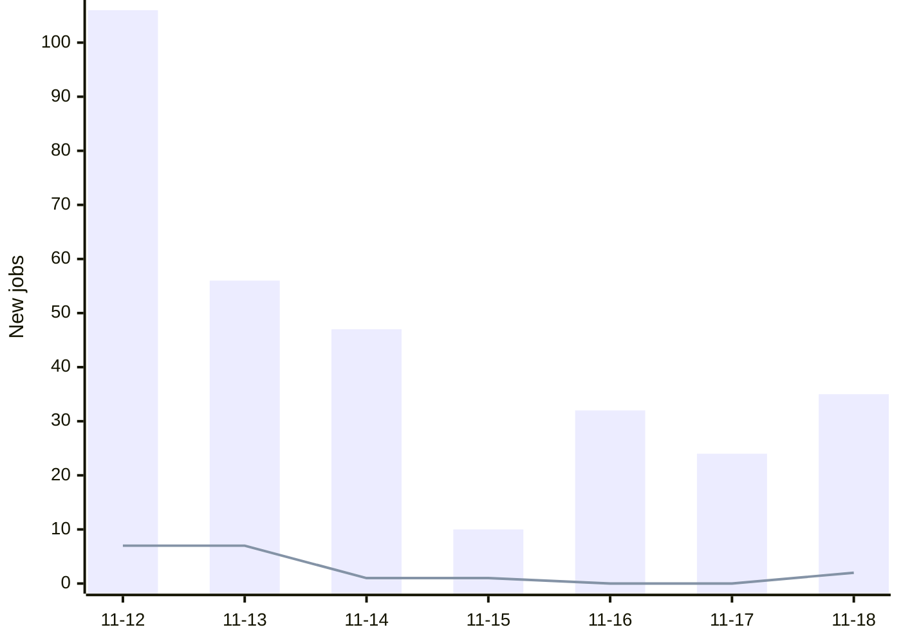

# Remote Software Job Tracker

Tracks remote **software development** jobs every day, sorts them by role (frontend, backend,
full-stack, mobile and more), and flags the ones open to candidates in Kenya. A GitHub Actions workflow runs a Python script on a schedule, fetches listings
from the [Remotive](https://remotive.com) and [Jobicy](https://jobicy.com) public APIs, deduplicates them, and commits the updated data.

**Live site:** https://mwangimark.github.io/frontend-job-tracker/ (Angular app in `site/`, redeployed after every update)

**Last updated:** 2026-11-18 · **Jobs tracked:** 310 · **Open to Kenya:** 18 ·
**New today:** 35 (2 open to Kenya)

**By role:** General Software: 78 · Data & AI: 46 · Full-stack: 34 · Solutions & Integrations: 33 · Engineering Leadership: 28 · Backend: 25 · QA & Testing: 19 · DevOps & Cloud: 15 · Frontend: 13 · Embedded & Systems: 13 · Mobile: 6

## New jobs per day (last 30 days)

Bars: all new jobs. Line: new jobs open to Kenya.

## Latest 20 jobs

| Published | Job | Role | Company | Location | Open to Kenya |
|---|---|---|---|---|---|
| 2026-11-18 | [Full Stack Developer (Frontend-Focused) - Mexico](https://jobicy.com/jobs/155665-full-stack-developer-frontend-focused-mexico) | Full-stack | Brafton | Mexico |  |
| 2026-11-18 | [Senior QA Engineer](https://jobicy.com/jobs/155766-senior-qa-engineer-3) | QA & Testing | Airtm | LATAM,  Canada,  USA |  |
| 2026-11-18 | [Staff Software Engineer - Python, Java / Spring or Go](https://jobicy.com/jobs/155731-staff-software-engineer-python-java-spring-or-go) | Backend | Bloomreach | Europe |  |
| 2026-11-18 | [Senior Software Engineer, Data Pipeline](https://jobicy.com/jobs/155730-senior-software-engineer-data-pipeline) | Data & AI | Bloomreach | Europe |  |
| 2026-11-18 | [Machine Learning Engineer (Governance ML Platform)](https://jobicy.com/jobs/155746-machine-learning-engineer-governance-ml-platform) | DevOps & Cloud | EDB | EMEA | ✅ |
| 2026-11-18 | [Full Stack Software Engineer](https://jobicy.com/jobs/155744-full-stack-software-engineer-2) | Full-stack | BetterHelp | USA |  |
| 2026-11-18 | [Manager, Engineering (Remote Eligible in Bulgaria)](https://jobicy.com/jobs/155726-manager-engineering-remote-eligible-in-bulgaria) | General Software | Smartsheet | Bulgaria |  |
| 2026-11-18 | [Ads Quality Rater – German (Austria)](https://jobicy.com/jobs/155692-ads-quality-rater-german-austria) | QA & Testing | Welo Global | Austria |  |
| 2026-11-18 | [Ads Quality Rater - Slovenian (Slovenia)](https://jobicy.com/jobs/155689-ads-quality-rater-slovenian-slovenia) | QA & Testing | Welo Global | Slovenia |  |
| 2026-11-18 | [Ads Quality Rater – Język polski (Polska)](https://jobicy.com/jobs/155695-ads-quality-rater-jezyk-polski-polska) | QA & Testing | Welo Global | Poland |  |
| 2026-11-18 | [Full Stack Developer (Frontend-Focused) - Brazil](https://jobicy.com/jobs/155661-full-stack-developer-frontend-focused-brazil) | Full-stack | Brafton | Brazil |  |
| 2026-11-18 | [Software Engineer](https://jobicy.com/jobs/155660-software-engineer-12) | General Software | Flex | Brazil |  |
| 2026-11-18 | [Senior Software Engineer, AI Engineer (Brazil)](https://jobicy.com/jobs/155662-senior-software-engineer-ai-engineer-brazil) | Data & AI | TRM Labs | Brazil |  |
| 2026-11-18 | [Senior Fullstack Engineer](https://jobicy.com/jobs/155655-senior-fullstack-engineer-3) | Full-stack | Spotify | Sweden,  UK |  |
| 2026-11-18 | [Ads Quality Rater - Norwegian (Norway)](https://jobicy.com/jobs/155652-ads-quality-rater-norwegian-norway) | QA & Testing | Welo Global | Norway |  |
| 2026-11-18 | [Ads Quality Rater - Slovak (Slovakia)](https://jobicy.com/jobs/155656-ads-quality-rater-slovak-slovakia) | QA & Testing | Welo Global | Slovakia |  |
| 2026-11-18 | [Senior C++/iOS Engineer - User Platform](https://jobicy.com/jobs/155651-senior-c-ios-engineer-user-platform) | Mobile | Spotify | Sweden,  UK |  |
| 2026-11-18 | [Software Engineer II - Poland](https://jobicy.com/jobs/155678-software-engineer-ii-poland) | General Software | Housecall Pro | Poland |  |
| 2026-11-18 | [Senior QA Automation Engineer - Product (LATAM)](https://jobicy.com/jobs/153469-senior-qa-automation-engineer-product-latam) | QA & Testing | Upgrade | Argentina,  Brazil |  |
| 2026-11-18 | [Director, AI Platforms](https://jobicy.com/jobs/155632-director-ai-platforms) | Engineering Leadership | Life360 | USA |  |

## How it works

- `.github/workflows/track-jobs.yml` runs daily at 08:17 EAT (and on demand).
- `scripts/track_jobs.py` fetches the software development category, classifies each job's role from its title, merges new jobs into
  `data/jobs.csv`, appends a row to `data/daily_stats.csv`, and regenerates this README.
- Only Python's standard library is used, so the workflow needs no dependencies.
- `.github/workflows/deploy-site.yml` rebuilds the Angular site in `site/` with the new data
  and deploys it to GitHub Pages.
- `scripts/send_alerts.py` emails subscribers their matching new jobs (daily, or weekly on Mondays).
  Subscribers are stored in Supabase (`supabase/schema.sql`); emails go out through Gmail SMTP.

Job data comes from [Remotive](https://remotive.com) and [Jobicy](https://jobicy.com); each link goes to the original listing.
