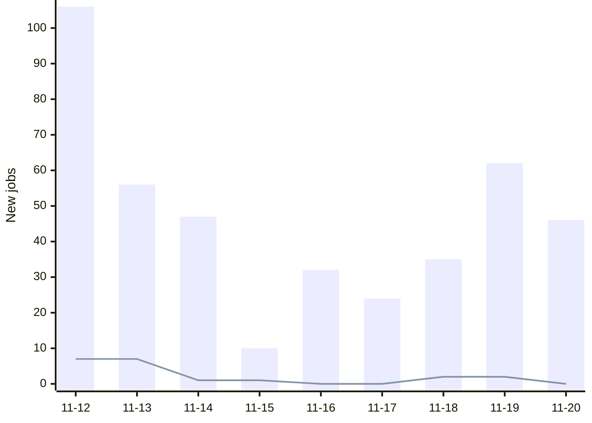

# Remote Software Job Tracker

Tracks remote **software development** jobs every day, sorts them by role (frontend, backend,
full-stack, mobile and more), and flags the ones open to candidates in Kenya. A GitHub Actions workflow runs a Python script on a schedule, fetches listings
from the [Remotive](https://remotive.com) and [Jobicy](https://jobicy.com) public APIs, deduplicates them, and commits the updated data.

**Live site:** https://mwangimark.github.io/frontend-job-tracker/ (Angular app in `site/`, redeployed after every update)

**Last updated:** 2026-11-20 · **Jobs tracked:** 418 · **Open to Kenya:** 20 ·
**New today:** 46 (0 open to Kenya)

**By role:** General Software: 110 · Data & AI: 55 · Full-stack: 44 · Solutions & Integrations: 44 · Backend: 33 · QA & Testing: 33 · Engineering Leadership: 32 · Mobile: 18 · DevOps & Cloud: 17 · Frontend: 17 · Embedded & Systems: 15

## New jobs per day (last 30 days)

Bars: all new jobs. Line: new jobs open to Kenya.

## Latest 20 jobs

| Published | Job | Role | Company | Location | Open to Kenya |
|---|---|---|---|---|---|
| 2026-11-20 | [Android Engineer (APAC Remote)](https://jobicy.com/jobs/163534-android-engineer-apac-remote) | Mobile | Binance | APAC |  |
| 2026-11-20 | [Backend Engineer (Ruby), AI Engineering: AI Catalog](https://jobicy.com/jobs/163519-backend-engineer-ruby-ai-engineering-ai-catalog) | Data & AI | GitLab | UK |  |
| 2026-11-20 | [Forward Deployed Engineer](https://jobicy.com/jobs/163496-forward-deployed-engineer-14) | Solutions & Integrations | Fin | USA |  |
| 2026-11-20 | [Senior AI Engineer](https://jobicy.com/jobs/163488-senior-ai-engineer-11) | Data & AI | Osano | USA |  |
| 2026-11-20 | [Director, AI Solutions](https://jobicy.com/jobs/163478-director-ai-solutions-2) | Engineering Leadership | Wpromote | USA |  |
| 2026-11-20 | [Senior Frontend Engineer, Foundations](https://jobicy.com/jobs/163468-senior-frontend-engineer-foundations) | Frontend | NetBox Labs | USA |  |
| 2026-11-20 | [Crux - Video and Audio QA - German (Germany)](https://jobicy.com/jobs/163459-crux-video-and-audio-qa-german-germany) | QA & Testing | Welo Global | Germany |  |
| 2026-11-20 | [Android Software Engineer](https://jobicy.com/jobs/163458-android-software-engineer) | Mobile | BJAK | Germany |  |
| 2026-11-20 | [Staff Software Engineer, OS Integration](https://jobicy.com/jobs/163456-staff-software-engineer-os-integration) | Solutions & Integrations | Mozilla | Germany |  |
| 2026-11-20 | [iOS Developer](https://jobicy.com/jobs/163455-ios-developer) | Mobile | BJAK | Germany |  |
| 2026-11-20 | [Android Engineer](https://jobicy.com/jobs/163435-android-engineer-2) | Mobile | Branch | USA |  |
| 2026-11-20 | [Senior Software Engineer: Assets](https://jobicy.com/jobs/163422-senior-software-engineer-assets) | General Software | Consensys | USA |  |
| 2026-11-20 | [Adobe Multi-Solution Architect (Firefly / GenStudio / Commerce) - Advertising](https://jobicy.com/jobs/163407-adobe-multi-solution-architect-firefly-genstudio-commerce-advertising) | General Software | Truelogic | Brazil |  |
| 2026-11-20 | [Senior Software Engineer, Data Platform](https://jobicy.com/jobs/163399-senior-software-engineer-data-platform-2) | DevOps & Cloud | TRM Labs | Brazil |  |
| 2026-11-20 | [Senior Front-End Engineer (Next.js/React) - Real Estate](https://jobicy.com/jobs/163397-senior-front-end-engineer-next-js-react-real-estate) | Frontend | Truelogic | Mexico |  |
| 2026-11-20 | [Backend Engineer (Ruby), Plan: Spec-Driven Development](https://jobicy.com/jobs/156080-backend-engineer-ruby-plan-spec-driven-development) | Backend | GitLab | UK |  |
| 2026-11-20 | [Manager, Engineering - Frontend](https://jobicy.com/jobs/156055-manager-engineering-frontend) | Frontend | Wrapbook | Canada,  USA |  |
| 2026-11-20 | [Engineering Manager, Knowledge Graph Platform](https://jobicy.com/jobs/156017-engineering-manager-knowledge-graph-platform) | Engineering Leadership | Reddit | Canada,  USA |  |
| 2026-11-20 | [Senior Electrical Delivery Engineer](https://jobicy.com/jobs/155997-senior-electrical-delivery-engineer) | General Software | Lambda | USA |  |
| 2026-11-20 | [Staff Software Engineer (Full-stack/Backend)](https://jobicy.com/jobs/155988-staff-software-engineer-full-stack-backend) | Full-stack | hims & hers | USA |  |

## How it works

- `.github/workflows/track-jobs.yml` runs daily at 08:17 EAT (and on demand).
- `scripts/track_jobs.py` fetches the software development category, classifies each job's role from its title, merges new jobs into
  `data/jobs.csv`, appends a row to `data/daily_stats.csv`, and regenerates this README.
- Only Python's standard library is used, so the workflow needs no dependencies.
- `.github/workflows/deploy-site.yml` rebuilds the Angular site in `site/` with the new data
  and deploys it to GitHub Pages.
- `scripts/send_alerts.py` emails subscribers their matching new jobs (daily, or weekly on Mondays).
  Subscribers are stored in Supabase (`supabase/schema.sql`); emails go out through Gmail SMTP.

Job data comes from [Remotive](https://remotive.com) and [Jobicy](https://jobicy.com); each link goes to the original listing.
