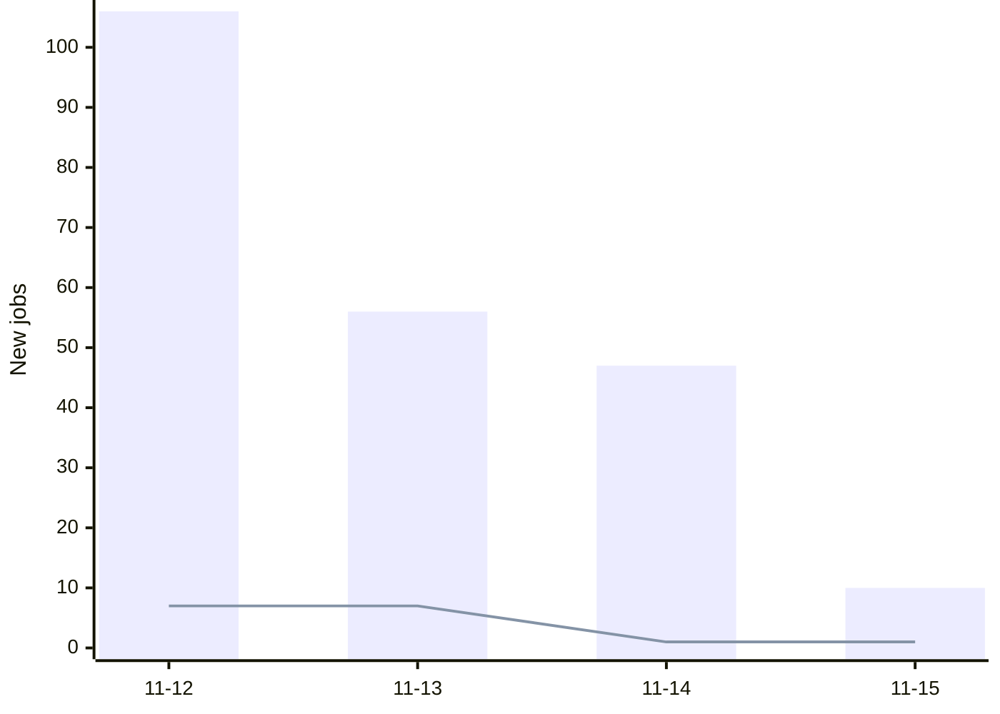

# Remote Software Job Tracker

Tracks remote **software development** jobs every day, sorts them by role (frontend, backend,
full-stack, mobile and more), and flags the ones open to candidates in Kenya. A GitHub Actions workflow runs a Python script on a schedule, fetches listings
from the [Remotive](https://remotive.com) and [Jobicy](https://jobicy.com) public APIs, deduplicates them, and commits the updated data.

**Live site:** https://mwangimark.github.io/frontend-job-tracker/ (Angular app in `site/`, redeployed after every update)

**Last updated:** 2026-11-15 · **Jobs tracked:** 219 · **Open to Kenya:** 16 ·
**New today:** 10 (1 open to Kenya)

**By role:** General Software: 51 · Data & AI: 35 · Solutions & Integrations: 25 · Full-stack: 22 · Engineering Leadership: 20 · Backend: 18 · Embedded & Systems: 12 · Frontend: 11 · DevOps & Cloud: 10 · QA & Testing: 10 · Mobile: 5

## New jobs per day (last 30 days)

Bars: all new jobs. Line: new jobs open to Kenya.

## Latest 20 jobs

| Published | Job | Role | Company | Location | Open to Kenya |
|---|---|---|---|---|---|
| 2026-11-15 | [Principal Software Engineer - XTM One](https://jobicy.com/jobs/162276-principal-software-engineer-xtm-one) | General Software | Filigran | France,  Germany,  Italy,  Portugal,  Spain,  UK |  |
| 2026-11-15 | [AI Platform Engineer](https://jobicy.com/jobs/155385-ai-platform-engineer) | DevOps & Cloud | Supabase | Anywhere | ✅ |
| 2026-11-15 | [Solutions Architect f/m/d](https://jobicy.com/jobs/155375-solutions-architect-f-m-d) | Solutions & Integrations | Apaleo | France |  |
| 2026-11-15 | [Junior Software Engineer](https://jobicy.com/jobs/153164-junior-software-engineer-2) | General Software | PolicyMe | Canada |  |
| 2026-11-15 | [Senior Forward Deployed Engineer](https://jobicy.com/jobs/155357-senior-forward-deployed-engineer-2) | Solutions & Integrations | Fleetio | Canada,  Mexico,  USA |  |
| 2026-11-14 | [Senior Systems Engineer – Avionics & Embedded Systems](https://jobicy.com/jobs/162243-senior-systems-engineer-avionics-embedded-systems) | Embedded & Systems | Quest Defense Systems & Solutions, Inc. | USA |  |
| 2026-11-14 | [Senior Mechanical Design Engineer - Structures & Systems](https://jobicy.com/jobs/162237-senior-mechanical-design-engineer-structures-systems) | General Software | Quest Defense Systems & Solutions, Inc. | USA |  |
| 2026-11-14 | [Senior Backend Engineer (Data serving)](https://jobicy.com/jobs/162192-senior-backend-engineer-data-serving-2) | Data & AI | Pleo | Denmark,  Portugal,  Spain,  UK |  |
| 2026-11-14 | [Senior Customer Integration Engineer](https://jobicy.com/jobs/162189-senior-customer-integration-engineer) | Solutions & Integrations | Unite Us | USA |  |
| 2026-11-14 | [Director, Finance Systems & ERP](https://jobicy.com/jobs/162183-director-finance-systems-erp) | Engineering Leadership | Smartsheet | USA |  |
| 2026-11-14 | [Senior Software Engineer, Frontend / Product Engineering](https://jobicy.com/jobs/162134-senior-software-engineer-frontend-product-engineering) | Frontend | TRM Labs | USA |  |
| 2026-11-14 | [Senior GTM Systems Engineer](https://jobicy.com/jobs/162127-senior-gtm-systems-engineer) | Solutions & Integrations | Apollo.io | USA |  |
| 2026-11-14 | [Senior Engineer, Server – NBA 2K](https://jobicy.com/jobs/162125-senior-engineer-server-nba-2k) | General Software | Visual Concepts | USA |  |
| 2026-11-14 | [Principal + Staff Software Engineers](https://jobicy.com/jobs/162122-principal-staff-software-engineers) | General Software | Unstructured Technologies Inc. | USA |  |
| 2026-11-14 | [Graphics Engineer - NBA 2K](https://jobicy.com/jobs/162121-graphics-engineer-nba-2k) | General Software | Visual Concepts | USA |  |
| 2026-11-14 | [Project Sceptrum - Multilingual AI Coding Evaluation Specialist - Dutch](https://jobicy.com/jobs/162115-project-sceptrum-multilingual-ai-coding-evaluation-specialist-dutch) | Data & AI | Welo Global | Netherlands |  |
| 2026-11-14 | [Senior Full Stack Engineer - Databases - Analytics / UK / Remote](https://jobicy.com/jobs/162114-senior-full-stack-engineer-databases-analytics-uk-remote) | Full-stack | Grafana Labs | Germany,  Ireland,  Spain,  Sweden,  UK |  |
| 2026-11-14 | [Senior Full Stack Engineer - Databases - Analytics / Sweden / Remote](https://jobicy.com/jobs/162112-senior-full-stack-engineer-databases-analytics-sweden-remote) | Full-stack | Grafana Labs | Germany,  Ireland,  Spain,  Sweden,  UK |  |
| 2026-11-14 | [Senior Full Stack Engineer - Databases, Analytics / Spain / Remote](https://jobicy.com/jobs/162108-senior-full-stack-engineer-databases-analytics-spain-remote) | Full-stack | Grafana Labs | Germany,  Ireland,  Spain,  Sweden,  UK |  |
| 2026-11-14 | [Senior Full Stack Engineer - Databases - Analytics / Ireland / Remote](https://jobicy.com/jobs/162104-senior-full-stack-engineer-databases-analytics-ireland-remote) | Full-stack | Grafana Labs | Germany,  Ireland,  Spain,  Sweden,  UK |  |

## How it works

- `.github/workflows/track-jobs.yml` runs daily at 08:17 EAT (and on demand).
- `scripts/track_jobs.py` fetches the software development category, classifies each job's role from its title, merges new jobs into
  `data/jobs.csv`, appends a row to `data/daily_stats.csv`, and regenerates this README.
- Only Python's standard library is used, so the workflow needs no dependencies.
- `.github/workflows/deploy-site.yml` rebuilds the Angular site in `site/` with the new data
  and deploys it to GitHub Pages.

Job data comes from [Remotive](https://remotive.com) and [Jobicy](https://jobicy.com); each link goes to the original listing.
