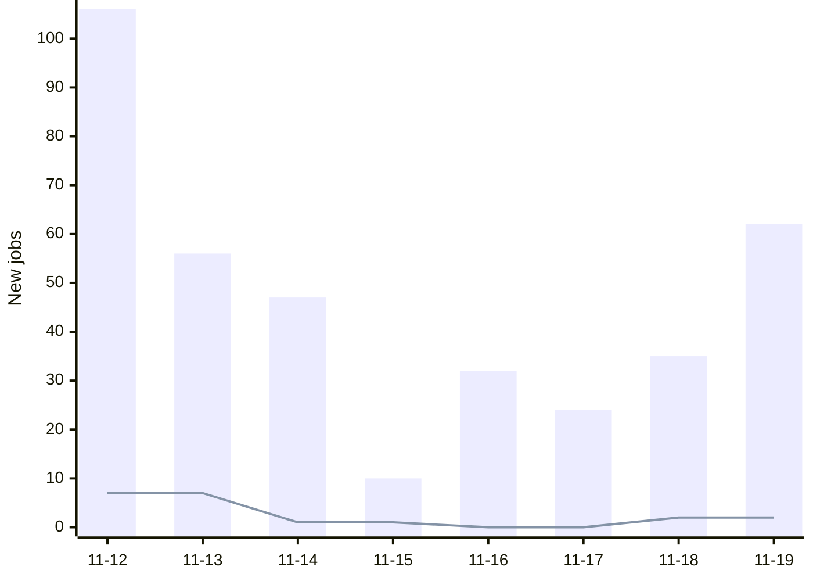

# Remote Software Job Tracker

Tracks remote **software development** jobs every day, sorts them by role (frontend, backend,
full-stack, mobile and more), and flags the ones open to candidates in Kenya. A GitHub Actions workflow runs a Python script on a schedule, fetches listings
from the [Remotive](https://remotive.com) and [Jobicy](https://jobicy.com) public APIs, deduplicates them, and commits the updated data.

**Live site:** https://mwangimark.github.io/frontend-job-tracker/ (Angular app in `site/`, redeployed after every update)

**Last updated:** 2026-11-19 · **Jobs tracked:** 372 · **Open to Kenya:** 20 ·
**New today:** 62 (2 open to Kenya)

**By role:** General Software: 101 · Data & AI: 52 · Full-stack: 42 · Solutions & Integrations: 40 · Backend: 29 · Engineering Leadership: 29 · QA & Testing: 22 · DevOps & Cloud: 16 · Frontend: 14 · Mobile: 14 · Embedded & Systems: 13

## New jobs per day (last 30 days)

Bars: all new jobs. Line: new jobs open to Kenya.

## Latest 20 jobs

| Published | Job | Role | Company | Location | Open to Kenya |
|---|---|---|---|---|---|
| 2026-11-19 | [iOS Developer - AI Finance Agent](https://jobicy.com/jobs/163264-ios-developer-ai-finance-agent) | Mobile | BJAK | Austria |  |
| 2026-11-19 | [Backend Software Engineer - AI Finance Agent](https://jobicy.com/jobs/163259-backend-software-engineer-ai-finance-agent) | Data & AI | BJAK | Austria |  |
| 2026-11-19 | [Forward Deployed Engineer](https://jobicy.com/jobs/163258-forward-deployed-engineer-13) | Solutions & Integrations | Collibra | Australia,  Europe,  USA |  |
| 2026-11-19 | [1192 - Sr. BIM Software Developer](https://jobicy.com/jobs/163256-1192-sr-bim-software-developer) | General Software | GoFasti | LATAM |  |
| 2026-11-19 | [Senior Java Developer](https://jobicy.com/jobs/163255-senior-java-developer) | Backend | MKS2 Technologies | USA |  |
| 2026-11-19 | [Founding Staff Software Engineer • Python/FastAPI](https://jobicy.com/jobs/163249-founding-staff-software-engineer-python-fastapi) | Backend | Neuroscale AI | USA |  |
| 2026-11-19 | [Mobile Application Developer - AI Finance Agent](https://jobicy.com/jobs/163239-mobile-application-developer-ai-finance-agent) | Mobile | BJAK | Sweden |  |
| 2026-11-19 | [Android Developer - AI Finance Agent](https://jobicy.com/jobs/163238-android-developer-ai-finance-agent) | Mobile | BJAK | Austria |  |
| 2026-11-19 | [Applied AI Engineer](https://jobicy.com/jobs/163236-applied-ai-engineer-4) | Data & AI | BJAK | Austria |  |
| 2026-11-19 | [Android Software Engineer - AI Finance Agent](https://jobicy.com/jobs/163234-android-software-engineer-ai-finance-agent) | Mobile | BJAK | Sweden |  |
| 2026-11-19 | [SIP Expert](https://jobicy.com/jobs/163233-sip-expert) | General Software | Elevenlabs | Europe |  |
| 2026-11-19 | [Full Stack Software Engineer - AI Finance Agent](https://jobicy.com/jobs/163230-full-stack-software-engineer-ai-finance-agent) | Full-stack | BJAK | Netherlands |  |
| 2026-11-19 | [Software Engineer - Agent Team](https://jobicy.com/jobs/163229-software-engineer-agent-team) | General Software | Automox | USA |  |
| 2026-11-19 | [Go-To-Market Engineer](https://jobicy.com/jobs/163223-go-to-market-engineer) | General Software | Automox | USA |  |
| 2026-11-19 | [Staff Software Engineer](https://jobicy.com/jobs/163221-staff-software-engineer-16) | General Software | DataGrail | USA |  |
| 2026-11-19 | [Senior Software Development Engineer in Test (SDET)](https://jobicy.com/jobs/155928-senior-software-development-engineer-in-test-sdet-2) | QA & Testing | Flex | Anywhere | ✅ |
| 2026-11-19 | [Forward Deployed Engineer - Software Engineer - Argentina](https://jobicy.com/jobs/155937-forward-deployed-engineer-software-engineer-argentina) | Solutions & Integrations | Elevenlabs | Argentina |  |
| 2026-11-19 | [Full-Stack Engineer (Backend Leaning) - Creative Agents](https://jobicy.com/jobs/155939-full-stack-engineer-backend-leaning-creative-agents) | Full-stack | Elevenlabs | Anywhere | ✅ |
| 2026-11-19 | [Forward Deployed Engineer - Software Engineer - Mexico](https://jobicy.com/jobs/155938-forward-deployed-engineer-software-engineer-mexico) | Solutions & Integrations | Elevenlabs | Mexico |  |
| 2026-11-19 | [Developer Experience Engineer](https://jobicy.com/jobs/155936-developer-experience-engineer) | General Software | Elevenlabs | Europe,  USA |  |

## How it works

- `.github/workflows/track-jobs.yml` runs daily at 08:17 EAT (and on demand).
- `scripts/track_jobs.py` fetches the software development category, classifies each job's role from its title, merges new jobs into
  `data/jobs.csv`, appends a row to `data/daily_stats.csv`, and regenerates this README.
- Only Python's standard library is used, so the workflow needs no dependencies.
- `.github/workflows/deploy-site.yml` rebuilds the Angular site in `site/` with the new data
  and deploys it to GitHub Pages.
- `scripts/send_alerts.py` emails subscribers their matching new jobs (daily, or weekly on Mondays).
  Subscribers are stored in Supabase (`supabase/schema.sql`); emails go out through Gmail SMTP.

Job data comes from [Remotive](https://remotive.com) and [Jobicy](https://jobicy.com); each link goes to the original listing.
