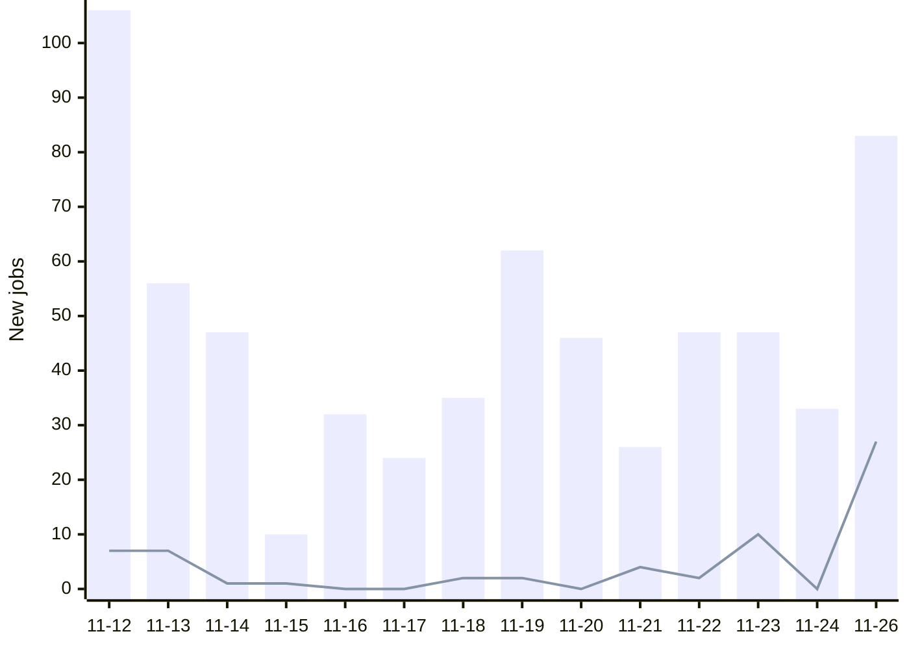

# Remote Software Job Tracker

Tracks remote **software development** jobs every day, sorts them by role (frontend, backend,
full-stack, mobile and more), and flags the ones open to candidates in Kenya. A GitHub Actions workflow runs a Python script on a schedule, fetches listings
from the [Remotive](https://remotive.com) and [Jobicy](https://jobicy.com) public APIs, deduplicates them, and commits the updated data.

**Live site:** https://mwangimark.github.io/frontend-job-tracker/ (Angular app in `site/`, redeployed after every update)

**Last updated:** 2026-11-26 · **Jobs tracked:** 654 · **Open to Kenya:** 63 ·
**New today:** 83 (27 open to Kenya)

**By role:** General Software: 199 · Data & AI: 82 · Solutions & Integrations: 57 · Full-stack: 55 · Backend: 55 · Engineering Leadership: 52 · QA & Testing: 50 · Mobile: 30 · DevOps & Cloud: 26 · Frontend: 25 · Embedded & Systems: 23

## New jobs per day (last 30 days)

Bars: all new jobs. Line: new jobs open to Kenya.

## Latest 20 jobs

| Published | Job | Role | Company | Location | Open to Kenya |
|---|---|---|---|---|---|
| 2026-11-26 | [Security Engineer](https://jobicy.com/jobs/164365-security-engineer-4) | General Software | Fever | Spain |  |
| 2026-11-26 | [Solutions Integration Architect - Workday](https://jobicy.com/jobs/164342-solutions-integration-architect-workday) | Solutions & Integrations | Zip | USA |  |
| 2026-11-26 | [Staff Software Developer](https://jobicy.com/jobs/164325-staff-software-developer-3) | General Software | Neo Financial | Canada |  |
| 2026-11-26 | [Backend Engineer - senior hire](https://jobicy.com/jobs/164324-backend-engineer-senior-hire) | Backend | Kovo | USA |  |
| 2026-11-26 | [Senior Test Software Engineer](https://jobicy.com/jobs/164323-senior-test-software-engineer) | QA & Testing | Focus Consulting LLC | USA |  |
| 2026-11-26 | [Full Stack Web Engineer (Python & React)](https://jobicy.com/jobs/164320-full-stack-web-engineer-python-react-2) | Full-stack | Oowlish Technology | Argentina,  Brazil,  Mexico |  |
| 2026-11-26 | [Senior Data Engineer, Datacraft team](https://jobicy.com/jobs/157270-senior-data-engineer-datacraft-team) | Data & AI | Bloomreach | Czechia |  |
| 2026-11-26 | [Manager, Software Engineering - Developer Experience](https://jobicy.com/jobs/157235-manager-software-engineering-developer-experience) | General Software | ClickUp | USA |  |
| 2026-11-26 | [Senior Software Engineer II, Applied AI](https://jobicy.com/jobs/157182-senior-software-engineer-ii-applied-ai) | Data & AI | Wrapbook | Canada,  USA |  |
| 2026-11-26 | [Backend Engineer, Java - Web 3 Wallet](https://jobicy.com/jobs/157144-backend-engineer-java-web-3-wallet) | Backend | Binance | Hong Kong,  Singapore |  |
| 2026-11-26 | [Machine Learning Engineer, New Grad - Quora](https://jobicy.com/jobs/157108-machine-learning-engineer-new-grad-quora) | Data & AI | Quora | Canada,  USA |  |
| 2026-11-26 | [Full Stack Software Engineer, New Grad - Quora](https://jobicy.com/jobs/157105-full-stack-software-engineer-new-grad-quora) | Full-stack | Quora | Canada,  USA |  |
| 2026-11-26 | [Frontend Engineer, Ads](https://jobicy.com/jobs/157086-frontend-engineer-ads) | Frontend | Reddit | USA |  |
| 2026-11-26 | [Safety Engineer (Backend Leaning)](https://jobicy.com/jobs/157048-safety-engineer-backend-leaning) | Backend | Elevenlabs | Ireland,  Japan,  Poland,  UK,  USA |  |
| 2026-11-26 | [Systems Architect - APAC](https://jobicy.com/jobs/157045-systems-architect-apac) | General Software | Elevenlabs | Singapore |  |
| 2026-11-26 | [Software Engineer](https://jobicy.com/jobs/154031-software-engineer-11) | General Software | Capital on Tap | Portugal |  |
| 2026-11-26 | [Junior Linux Kernel Engineer - Ubuntu](https://jobicy.com/jobs/149520-junior-linux-kernel-engineer-ubuntu) | Embedded & Systems | Canonical | Anywhere | ✅ |
| 2026-11-26 | [Lead Automation Engineer](https://jobicy.com/jobs/154027-lead-automation-engineer) | General Software | Capital on Tap | Portugal |  |
| 2026-11-26 | [Sr. Quality Engineer](https://jobicy.com/jobs/153999-sr-quality-engineer) | QA & Testing | CentralReach | USA |  |
| 2026-11-26 | [Staff Security Architect](https://jobicy.com/jobs/144336-staff-security-architect) | General Software | Kraken | EMEA,  LATAM,  Canada,  Europe | ✅ |

## How it works

- `.github/workflows/track-jobs.yml` runs daily at 08:17 EAT (and on demand).
- `scripts/track_jobs.py` fetches the software development category, classifies each job's role from its title, merges new jobs into
  `data/jobs.csv`, appends a row to `data/daily_stats.csv`, and regenerates this README.
- Only Python's standard library is used, so the workflow needs no dependencies.
- `.github/workflows/deploy-site.yml` rebuilds the Angular site in `site/` with the new data
  and deploys it to GitHub Pages.
- `scripts/send_alerts.py` emails subscribers their matching new jobs (daily, or weekly on Mondays).
  Subscribers are stored in Supabase (`supabase/schema.sql`); emails go out through Gmail SMTP.

Job data comes from [Remotive](https://remotive.com) and [Jobicy](https://jobicy.com); each link goes to the original listing.
