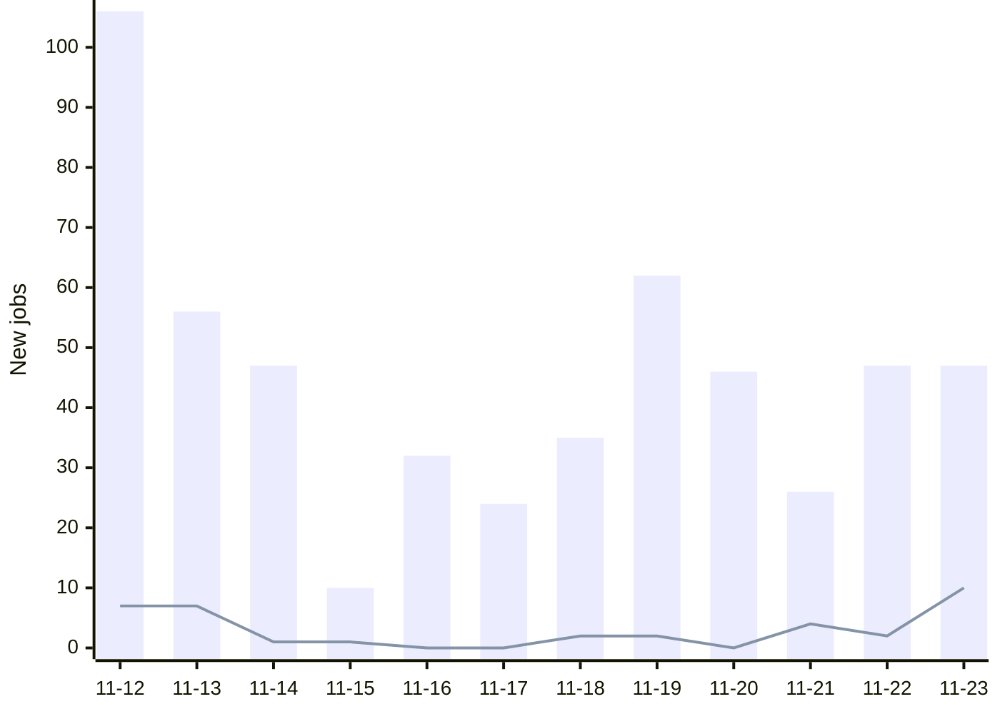

# Remote Software Job Tracker

Tracks remote **software development** jobs every day, sorts them by role (frontend, backend,
full-stack, mobile and more), and flags the ones open to candidates in Kenya. A GitHub Actions workflow runs a Python script on a schedule, fetches listings
from the [Remotive](https://remotive.com) and [Jobicy](https://jobicy.com) public APIs, deduplicates them, and commits the updated data.

**Live site:** https://mwangimark.github.io/frontend-job-tracker/ (Angular app in `site/`, redeployed after every update)

**Last updated:** 2026-11-23 · **Jobs tracked:** 538 · **Open to Kenya:** 36 ·
**New today:** 47 (10 open to Kenya)

**By role:** General Software: 148 · Data & AI: 69 · Solutions & Integrations: 52 · Full-stack: 50 · Engineering Leadership: 48 · Backend: 44 · QA & Testing: 42 · Mobile: 28 · Frontend: 22 · DevOps & Cloud: 20 · Embedded & Systems: 15

## New jobs per day (last 30 days)

Bars: all new jobs. Line: new jobs open to Kenya.

## Latest 20 jobs

| Published | Job | Role | Company | Location | Open to Kenya |
|---|---|---|---|---|---|
| 2026-11-23 | [Principal Software Engineer](https://jobicy.com/jobs/163960-principal-software-engineer-3) | General Software | BJAK | Austria |  |
| 2026-11-23 | [Lead Software Engineer](https://jobicy.com/jobs/163959-lead-software-engineer-2) | General Software | BJAK | Austria |  |
| 2026-11-23 | [Mobile Engineer - AI Finance Agent](https://jobicy.com/jobs/163946-mobile-engineer-ai-finance-agent) | Mobile | BJAK | Poland |  |
| 2026-11-23 | [Staff Software Engineer](https://jobicy.com/jobs/163941-staff-software-engineer-17) | General Software | BJAK | Austria |  |
| 2026-11-23 | [Mobile Developer - AI Finance Agent](https://jobicy.com/jobs/163933-mobile-developer-ai-finance-agent) | Mobile | BJAK | Sweden |  |
| 2026-11-23 | [AI Engineer](https://jobicy.com/jobs/163921-ai-engineer-6) | Data & AI | Makai Labs | USA |  |
| 2026-11-23 | [Software Engineer, Security, Stablecoin](https://jobicy.com/jobs/163919-software-engineer-security-stablecoin-2) | General Software | Ramp | USA |  |
| 2026-11-23 | [Senior Software Engineer](https://jobicy.com/jobs/163918-senior-software-engineer-29) | General Software | Makai Labs | USA |  |
| 2026-11-23 | [Staff Engineer - Telematics](https://jobicy.com/jobs/163895-staff-engineer-telematics-2) | General Software | Samsara | UK |  |
| 2026-11-23 | [Senior Android Engineer](https://jobicy.com/jobs/156680-senior-android-engineer-4) | Mobile | Medium | USA |  |
| 2026-11-23 | [Engineering Manager, Switchboard](https://jobicy.com/jobs/156660-engineering-manager-switchboard) | Engineering Leadership | GitLab | UK |  |
| 2026-11-23 | [Mobile Principal Software Engineer](https://jobicy.com/jobs/156651-mobile-principal-software-engineer) | Mobile | dscout | USA |  |
| 2026-11-23 | [Forward Deployed Engineer](https://jobicy.com/jobs/156602-forward-deployed-engineer-8) | Solutions & Integrations | Banyan Software | Belgium,  Germany,  Netherlands,  UK |  |
| 2026-11-23 | [Engineering Manager- Ceph & Distributed Storage](https://jobicy.com/jobs/156571-engineering-manager-ceph-distributed-storage-2) | Engineering Leadership | Canonical | EMEA,  LATAM,  Canada,  USA | ✅ |
| 2026-11-23 | [Senior Manager, Software Engineering - AI](https://jobicy.com/jobs/156593-senior-manager-software-engineering-ai) | Data & AI | NetDocuments | USA |  |
| 2026-11-23 | [Engineering Director - Commercial Systems](https://jobicy.com/jobs/156570-engineering-director-commercial-systems) | Engineering Leadership | Canonical | EMEA | ✅ |
| 2026-11-23 | [Engineering Director - Business Data](https://jobicy.com/jobs/156569-engineering-director-business-data) | Engineering Leadership | Canonical | EMEA | ✅ |
| 2026-11-23 | [Senior Software Engineer, Backend](https://jobicy.com/jobs/156558-senior-software-engineer-backend-4) | Backend | Customer.io | EMEA | ✅ |
| 2026-11-23 | [Performance Engineer - Benchmarking](https://jobicy.com/jobs/156582-performance-engineer-benchmarking) | General Software | Supabase | Anywhere | ✅ |
| 2026-11-23 | [Performance Engineer - Performance Analysis & Tuning](https://jobicy.com/jobs/156581-performance-engineer-performance-analysis-tuning) | General Software | Supabase | Anywhere | ✅ |

## How it works

- `.github/workflows/track-jobs.yml` runs daily at 08:17 EAT (and on demand).
- `scripts/track_jobs.py` fetches the software development category, classifies each job's role from its title, merges new jobs into
  `data/jobs.csv`, appends a row to `data/daily_stats.csv`, and regenerates this README.
- Only Python's standard library is used, so the workflow needs no dependencies.
- `.github/workflows/deploy-site.yml` rebuilds the Angular site in `site/` with the new data
  and deploys it to GitHub Pages.
- `scripts/send_alerts.py` emails subscribers their matching new jobs (daily, or weekly on Mondays).
  Subscribers are stored in Supabase (`supabase/schema.sql`); emails go out through Gmail SMTP.

Job data comes from [Remotive](https://remotive.com) and [Jobicy](https://jobicy.com); each link goes to the original listing.
