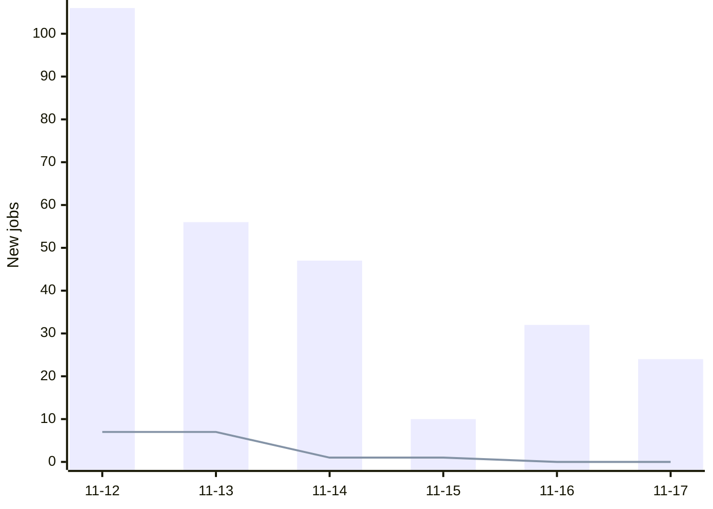

# Remote Software Job Tracker

Tracks remote **software development** jobs every day, sorts them by role (frontend, backend,
full-stack, mobile and more), and flags the ones open to candidates in Kenya. A GitHub Actions workflow runs a Python script on a schedule, fetches listings
from the [Remotive](https://remotive.com) and [Jobicy](https://jobicy.com) public APIs, deduplicates them, and commits the updated data.

**Live site:** https://mwangimark.github.io/frontend-job-tracker/ (Angular app in `site/`, redeployed after every update)

**Last updated:** 2026-11-17 · **Jobs tracked:** 275 · **Open to Kenya:** 16 ·
**New today:** 24 (0 open to Kenya)

**By role:** General Software: 70 · Data & AI: 42 · Solutions & Integrations: 30 · Full-stack: 28 · Engineering Leadership: 26 · Backend: 24 · DevOps & Cloud: 13 · Embedded & Systems: 13 · Frontend: 12 · QA & Testing: 12 · Mobile: 5

## New jobs per day (last 30 days)

Bars: all new jobs. Line: new jobs open to Kenya.

## Latest 20 jobs

| Published | Job | Role | Company | Location | Open to Kenya |
|---|---|---|---|---|---|
| 2026-11-17 | [Senior Software Engineer, Developer Experience](https://jobicy.com/jobs/162755-senior-software-engineer-developer-experience-2) | General Software | Thumbtack | USA |  |
| 2026-11-17 | [Senior Software Engineer, Builder Studio](https://jobicy.com/jobs/162753-senior-software-engineer-builder-studio) | General Software | Apollo.io | Canada,  USA |  |
| 2026-11-17 | [Systems Engineer – Nuclear I&C / BWR](https://jobicy.com/jobs/162749-systems-engineer-nuclear-ic-bwr) | General Software | Quest Defense Systems & Solutions, Inc. | USA |  |
| 2026-11-17 | [Compiler Engineer - Algorithmic Workloads Compilation](https://jobicy.com/jobs/162747-compiler-engineer-algorithmic-workloads-compilation) | General Software | Mythic | Canada,  USA |  |
| 2026-11-17 | [Sr. Systems Engineer – Flight Management System (FMS)](https://jobicy.com/jobs/162743-sr-systems-engineer-flight-management-system-fms) | General Software | Quest Defense Systems & Solutions, Inc. | USA |  |
| 2026-11-17 | [Software Verification Engineer](https://jobicy.com/jobs/162734-software-verification-engineer) | General Software | Quest Defense Systems & Solutions, Inc. | USA |  |
| 2026-11-17 | [AI Algorithms/Software Engineer](https://jobicy.com/jobs/162740-ai-algorithms-software-engineer) | Data & AI | Mythic | USA |  |
| 2026-11-17 | [AI Engineer - 4 Day Week + Remote](https://jobicy.com/jobs/155579-ai-engineer-4-day-week-remote) | Data & AI | Laminar Projects | Poland,  Portugal |  |
| 2026-11-17 | [Ads Quality Rater - Hebrew (Israel)](https://jobicy.com/jobs/155611-ads-quality-rater-hebrew-israel) | QA & Testing | Welo Global | Israel |  |
| 2026-11-17 | [Senior Backend Engineer (Booking Integrations, Contract)](https://jobicy.com/jobs/155600-senior-backend-engineer-booking-integrations-contract) | Solutions & Integrations | Aescape | USA |  |
| 2026-11-17 | [Engineering Director, EU](https://jobicy.com/jobs/155587-engineering-director-eu) | Engineering Leadership | Monzo | UK |  |
| 2026-11-17 | [Power Platform Developer](https://jobicy.com/jobs/155575-power-platform-developer) | DevOps & Cloud | Oddball | USA |  |
| 2026-11-17 | [Chief Technology Officer](https://jobicy.com/jobs/153308-chief-technology-officer-3) | General Software | Toptal | LATAM,  Canada,  Europe |  |
| 2026-11-17 | [Engineering Manager - EU](https://jobicy.com/jobs/150687-engineering-manager-eu) | Engineering Leadership | Ashby | Europe |  |
| 2026-11-17 | [Customer Solutions Engineer – Payments](https://jobicy.com/jobs/149199-customer-solutions-engineer-payments) | Solutions & Integrations | Zuora | USA |  |
| 2026-11-17 | [Software Engineer (Technical Leadership)](https://jobicy.com/jobs/150665-software-engineer-technical-leadership) | General Software | Meta | USA |  |
| 2026-11-16 | [Senior Software Engineer, Agentic Customer Platform (Poland, Remote, B2B)](https://jobicy.com/jobs/162707-senior-software-engineer-agentic-customer-platform-poland-remote-b2b-2) | DevOps & Cloud | Samsara | Poland |  |
| 2026-11-16 | [Product Engineer (AI Driven)](https://jobicy.com/jobs/162678-product-engineer-ai-driven) | Data & AI | AE Studio | Brazil |  |
| 2026-11-16 | [Staff Software Engineer, CKD](https://jobicy.com/jobs/162653-staff-software-engineer-ckd) | General Software | NerdWallet | USA |  |
| 2026-11-16 | [Senior Software Engineer](https://jobicy.com/jobs/162635-senior-software-engineer-25) | General Software | NerdWallet | USA |  |

## How it works

- `.github/workflows/track-jobs.yml` runs daily at 08:17 EAT (and on demand).
- `scripts/track_jobs.py` fetches the software development category, classifies each job's role from its title, merges new jobs into
  `data/jobs.csv`, appends a row to `data/daily_stats.csv`, and regenerates this README.
- Only Python's standard library is used, so the workflow needs no dependencies.
- `.github/workflows/deploy-site.yml` rebuilds the Angular site in `site/` with the new data
  and deploys it to GitHub Pages.
- `scripts/send_alerts.py` emails subscribers their matching new jobs (daily, or weekly on Mondays).
  Subscribers are stored in Supabase (`supabase/schema.sql`); emails go out through Gmail SMTP.

Job data comes from [Remotive](https://remotive.com) and [Jobicy](https://jobicy.com); each link goes to the original listing.
