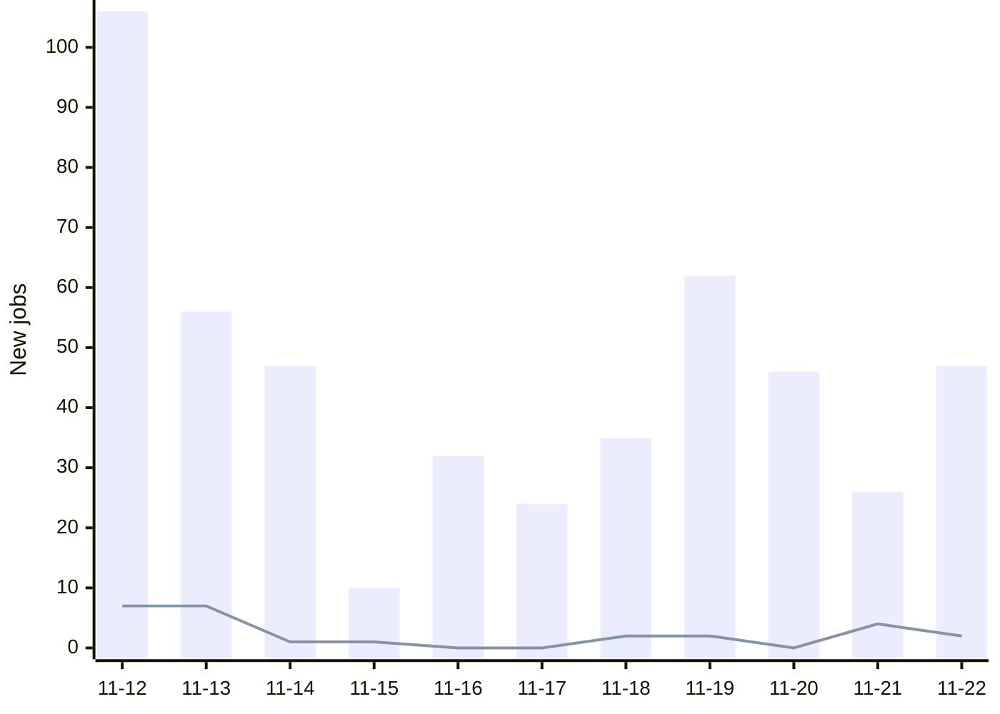

# Remote Software Job Tracker

Tracks remote **software development** jobs every day, sorts them by role (frontend, backend,
full-stack, mobile and more), and flags the ones open to candidates in Kenya. A GitHub Actions workflow runs a Python script on a schedule, fetches listings
from the [Remotive](https://remotive.com) and [Jobicy](https://jobicy.com) public APIs, deduplicates them, and commits the updated data.

**Live site:** https://mwangimark.github.io/frontend-job-tracker/ (Angular app in `site/`, redeployed after every update)

**Last updated:** 2026-11-22 · **Jobs tracked:** 491 · **Open to Kenya:** 26 ·
**New today:** 47 (2 open to Kenya)

**By role:** General Software: 133 · Data & AI: 63 · Full-stack: 49 · Solutions & Integrations: 49 · Backend: 41 · QA & Testing: 41 · Engineering Leadership: 40 · Frontend: 21 · Mobile: 21 · DevOps & Cloud: 18 · Embedded & Systems: 15

## New jobs per day (last 30 days)

Bars: all new jobs. Line: new jobs open to Kenya.

## Latest 20 jobs

| Published | Job | Role | Company | Location | Open to Kenya |
|---|---|---|---|---|---|
| 2026-11-22 | [Crux - Video and Audio QA - French (France)](https://jobicy.com/jobs/163823-crux-video-and-audio-qa-french-france) | QA & Testing | Welo Global | France |  |
| 2026-11-22 | [Andromeda Delta - Audio Transcription QA Turkish (Turkey)](https://jobicy.com/jobs/163820-andromeda-delta-audio-transcription-qa-turkish-turkey) | QA & Testing | Welo Global | Türkiye |  |
| 2026-11-22 | [Software Engineer (Remote - Contractor)](https://jobicy.com/jobs/163811-software-engineer-remote-contractor-2) | Engineering Leadership | Masabi | Romania |  |
| 2026-11-22 | [English to Belarusian Review Lead for UI, Marketing & Product Content](https://jobicy.com/jobs/163798-english-to-belarusian-review-lead-for-ui-marketing-product-content) | General Software | Welo Global | Argentina,  Australia,  Austria,  Belgium,  Brazil,  Bulgaria,  Canada,  China,  Costa Rica,  Croatia,  Czechia,  Denmark,  Finland,  France,  Germany,  Greece,  Hong Kong,  Hungary,  Ireland,  Israel,  Italy,  Japan,  Lithuania,  Malaysia,  Mexico,  Netherlands,  New Zealand,  Norway,  Philippines,  Poland,  Portugal,  Romania,  Singapore,  South Korea,  Spain,  Sweden,  Switzerland,  Thailand,  Türkiye,  UAE,  UK,  USA,  Vietnam |  |
| 2026-11-22 | [Product Engineering Lead - Andera](https://jobicy.com/jobs/163776-product-engineering-lead-andera) | General Software | Pear VC | USA |  |
| 2026-11-22 | [Founding Engineer - Abacus](https://jobicy.com/jobs/163772-founding-engineer-abacus) | General Software | Pear VC | USA |  |
| 2026-11-22 | [Founding Software Engineer - Vimes](https://jobicy.com/jobs/163768-founding-software-engineer-vimes) | General Software | Pear VC | USA |  |
| 2026-11-22 | [Senior Frontend Engineer - Endless Commerce](https://jobicy.com/jobs/163764-senior-frontend-engineer-endless-commerce) | Frontend | Pear VC | USA |  |
| 2026-11-22 | [Senior Backend Engineer - Endless Commerce](https://jobicy.com/jobs/163760-senior-backend-engineer-endless-commerce) | Backend | Pear VC | USA |  |
| 2026-11-22 | [Principal Agentic Engineer, AI Ecosystem](https://jobicy.com/jobs/163759-principal-agentic-engineer-ai-ecosystem) | Data & AI | Life360 | USA |  |
| 2026-11-22 | [Senior Native Application Engineer](https://jobicy.com/jobs/163739-senior-native-application-engineer) | General Software | FloSports, Inc. | USA |  |
| 2026-11-22 | [Software Engineer (Engineer III to Principal) - Formal Methods](https://jobicy.com/jobs/156398-software-engineer-engineer-iii-to-principal-formal-methods) | General Software | CertiK | USA |  |
| 2026-11-22 | [Senior Director, Agentic Engineering](https://jobicy.com/jobs/156460-senior-director-agentic-engineering) | Engineering Leadership | Lightspeed Commerce | USA |  |
| 2026-11-22 | [Senior Software Engineer (PHP)](https://jobicy.com/jobs/156456-senior-software-engineer-php) | Backend | NFQ | Poland |  |
| 2026-11-22 | [Research Engineer - Web Crawlers](https://jobicy.com/jobs/156436-research-engineer-web-crawlers) | General Software | Elevenlabs | Bulgaria,  Poland,  UK,  USA |  |
| 2026-11-22 | [Staff Forward Deployed Engineer](https://jobicy.com/jobs/156425-staff-forward-deployed-engineer) | Solutions & Integrations | hims & hers | USA |  |
| 2026-11-22 | [Senior Staff Engineer, iOS](https://jobicy.com/jobs/156356-senior-staff-engineer-ios) | Mobile | AlphaSense | UK |  |
| 2026-11-22 | [Senior Staff Engineer, Android](https://jobicy.com/jobs/156354-senior-staff-engineer-android) | Mobile | AlphaSense | UK |  |
| 2026-11-22 | [Senior Software Enginner (Full-stack Node + React)](https://jobicy.com/jobs/153741-senior-software-enginner-full-stack-node-react) | Full-stack | Airtm | LATAM |  |
| 2026-11-22 | [Senior AI/ML Engineer](https://jobicy.com/jobs/156322-senior-ai-ml-engineer) | Data & AI | Limbic | Canada |  |

## How it works

- `.github/workflows/track-jobs.yml` runs daily at 08:17 EAT (and on demand).
- `scripts/track_jobs.py` fetches the software development category, classifies each job's role from its title, merges new jobs into
  `data/jobs.csv`, appends a row to `data/daily_stats.csv`, and regenerates this README.
- Only Python's standard library is used, so the workflow needs no dependencies.
- `.github/workflows/deploy-site.yml` rebuilds the Angular site in `site/` with the new data
  and deploys it to GitHub Pages.
- `scripts/send_alerts.py` emails subscribers their matching new jobs (daily, or weekly on Mondays).
  Subscribers are stored in Supabase (`supabase/schema.sql`); emails go out through Gmail SMTP.

Job data comes from [Remotive](https://remotive.com) and [Jobicy](https://jobicy.com); each link goes to the original listing.
