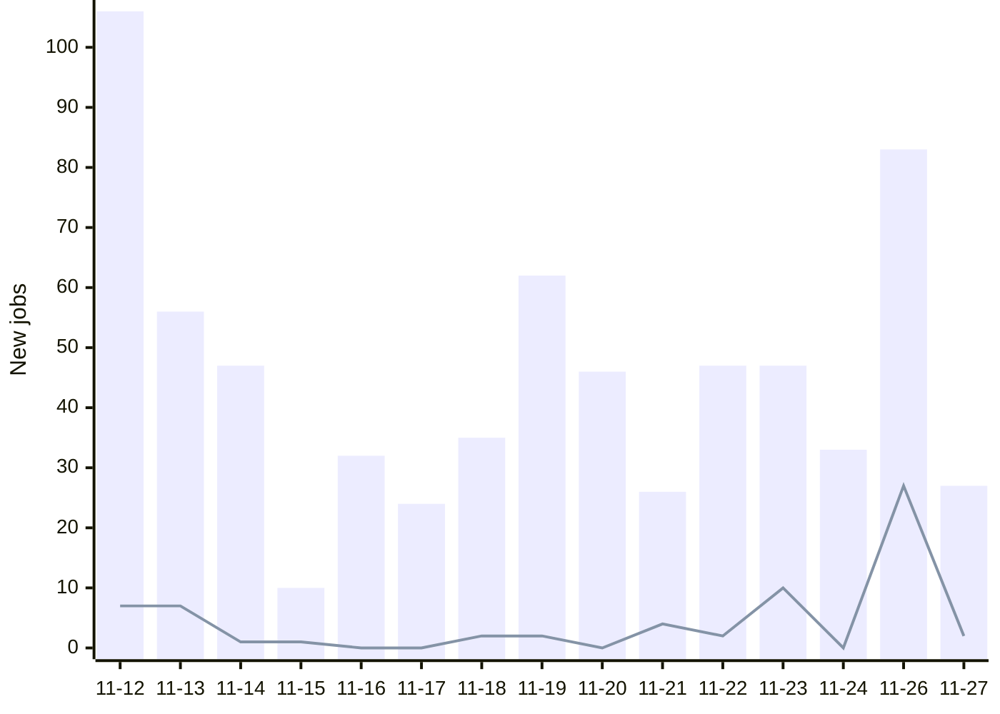

# Remote Software Job Tracker

Tracks remote **software development** jobs every day, sorts them by role (frontend, backend,
full-stack, mobile and more), and flags the ones open to candidates in Kenya. A GitHub Actions workflow runs a Python script on a schedule, fetches listings
from the [Remotive](https://remotive.com) and [Jobicy](https://jobicy.com) public APIs, deduplicates them, and commits the updated data.

**Live site:** https://mwangimark.github.io/frontend-job-tracker/ (Angular app in `site/`, redeployed after every update)

**Last updated:** 2026-11-27 · **Jobs tracked:** 681 · **Open to Kenya:** 65 ·
**New today:** 27 (2 open to Kenya)

**By role:** General Software: 205 · Data & AI: 85 · Engineering Leadership: 61 · Full-stack: 60 · Solutions & Integrations: 58 · Backend: 55 · QA & Testing: 52 · Mobile: 31 · DevOps & Cloud: 26 · Frontend: 25 · Embedded & Systems: 23

## New jobs per day (last 30 days)

Bars: all new jobs. Line: new jobs open to Kenya.

## Latest 20 jobs

| Published | Job | Role | Company | Location | Open to Kenya |
|---|---|---|---|---|---|
| 2026-11-27 | [Principal Engineering Manager, AI Care](https://jobicy.com/jobs/164486-principal-engineering-manager-ai-care) | Engineering Leadership | Pair Team | USA |  |
| 2026-11-27 | [Mobile Engineer](https://jobicy.com/jobs/164485-mobile-engineer-2) | Mobile | Fin | USA |  |
| 2026-11-27 | [Software Engineer](https://jobicy.com/jobs/164483-software-engineer-15) | General Software | Twilio | Ireland |  |
| 2026-11-27 | [Freelance Software Tester / Remote (Malaysia)](https://jobicy.com/jobs/164482-freelance-software-tester-remote-malaysia) | QA & Testing | Testlio | Malaysia |  |
| 2026-11-27 | [Freelance Software Tester / Remote (Argentina)](https://jobicy.com/jobs/164475-freelance-software-tester-remote-argentina) | QA & Testing | Testlio | Argentina |  |
| 2026-11-27 | [Senior Engineering Manager, Grafana Frontend / Germany / Remote](https://jobicy.com/jobs/157408-senior-engineering-manager-grafana-frontend-germany-remote) | Engineering Leadership | Grafana Labs | Germany |  |
| 2026-11-27 | [Engineering Manager - Ubuntu Core](https://jobicy.com/jobs/157405-engineering-manager-ubuntu-core) | Engineering Leadership | Canonical | EMEA,  LATAM,  Canada,  USA | ✅ |
| 2026-11-27 | [Engineering Manager](https://jobicy.com/jobs/157378-engineering-manager-14) | Engineering Leadership | Socket | USA |  |
| 2026-11-27 | [Engineering Manager](https://jobicy.com/jobs/157337-engineering-manager-13) | Engineering Leadership | Customer.io | LATAM,  Canada,  USA |  |
| 2026-11-27 | [Staff Software Engineer](https://jobicy.com/jobs/157273-staff-software-engineer-11) | General Software | AudioEye | USA |  |
| 2026-11-27 | [Staff Engineer, Full Stack (Trust, Safety & Risk)](https://jobicy.com/jobs/154084-staff-engineer-full-stack-trust-safety-risk) | Full-stack | Phantom | EMEA,  LATAM,  Canada,  USA | ✅ |
| 2026-11-27 | [Engineering Manager - Canada](https://jobicy.com/jobs/151633-engineering-manager-canada) | Engineering Leadership | Ashby | Canada |  |
| 2026-11-27 | [VP of Engineering](https://jobicy.com/jobs/157288-vp-of-engineering-2) | Engineering Leadership | Oddball | USA |  |
| 2026-11-27 | [OrioleDB Developer (AMER)](https://jobicy.com/jobs/154087-orioledb-developer-amer) | General Software | Supabase | LATAM,  Canada,  USA |  |
| 2026-11-27 | [Engineering Manager - UK](https://jobicy.com/jobs/151620-engineering-manager-uk) | Engineering Leadership | Ashby | UK |  |
| 2026-11-27 | [Senior ML Engineer](https://jobicy.com/jobs/151566-senior-ml-engineer) | Data & AI | Quilter | USA |  |
| 2026-11-27 | [Engineering Manager - Americas](https://jobicy.com/jobs/151638-engineering-manager-americas) | Engineering Leadership | Ashby | Canada,  USA |  |
| 2026-11-27 | [Software Engineer (All Levels)](https://jobicy.com/jobs/151601-software-engineer-all-levels) | General Software | Fieldguide | USA |  |
| 2026-11-27 | [Staff ML Systems Engineer](https://jobicy.com/jobs/151571-staff-ml-systems-engineer) | Data & AI | Quilter | USA |  |
| 2026-11-26 | [Agent Engineer - US Remote](https://jobicy.com/jobs/164452-agent-engineer-us-remote) | General Software | TRM Labs | USA |  |

## How it works

- `.github/workflows/track-jobs.yml` runs daily at 08:17 EAT (and on demand).
- `scripts/track_jobs.py` fetches the software development category, classifies each job's role from its title, merges new jobs into
  `data/jobs.csv`, appends a row to `data/daily_stats.csv`, and regenerates this README.
- Only Python's standard library is used, so the workflow needs no dependencies.
- `.github/workflows/deploy-site.yml` rebuilds the Angular site in `site/` with the new data
  and deploys it to GitHub Pages.
- `scripts/send_alerts.py` emails subscribers their matching new jobs (daily, or weekly on Mondays).
  Subscribers are stored in Supabase (`supabase/schema.sql`); emails go out through Gmail SMTP.

Job data comes from [Remotive](https://remotive.com) and [Jobicy](https://jobicy.com); each link goes to the original listing.
