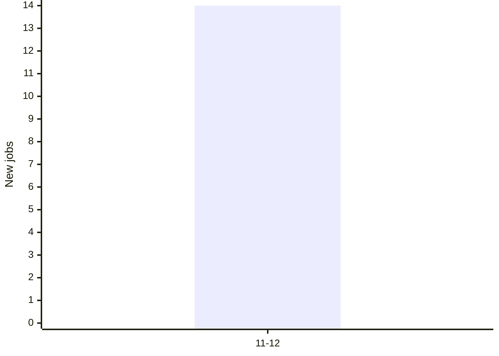

# Remote Frontend Job Tracker

Tracks remote **Angular, TypeScript and frontend** roles every day and flags the ones open to
candidates in Kenya. A GitHub Actions workflow runs a Python script on a schedule, fetches listings
from the [Remotive](https://remotive.com) public API, deduplicates them, and commits the updated data.

**Last updated:** 2026-11-12 · **Jobs tracked:** 14 · **Open to Kenya:** 9 ·
**New today:** 14 (9 open to Kenya)

## New jobs per day (last 30 days)

Bars: all new jobs. Line: new jobs open to Kenya.

## Latest 20 jobs

| Published | Role | Company | Location | Open to Kenya |
|---|---|---|---|---|
| 2026-11-10 | [Senior React Full-stack Developer](https://remotive.com/remote-jobs/software-development/senior-react-full-stack-developer-2091136) | Lemon.io | LATAM, Europe, USA, Canada, APAC |  |
| 2026-11-08 | [Inside Sales Contractor](https://remotive.com/remote-jobs/sales/inside-sales-contractor-2086540) | Credit Wellness, LLC | Worldwide | ✅ |
| 2026-11-07 | [Tier III Service Desk Engineer](https://remotive.com/remote-jobs/information-technology/tier-iii-service-desk-engineer-2091045) | Unio Digital | Worldwide | ✅ |
| 2026-11-06 | [US Remote Patient Care Advocate (Customer Service)](https://remotive.com/remote-jobs/customer-service/us-remote-patient-care-advocate-customer-service-2091168) | VXI Global Solutions | USA |  |
| 2026-11-04 | [Freelance Writer](https://remotive.com/remote-jobs/writing/freelance-writer-1185979) | IAPWE | Worldwide | ✅ |
| 2026-11-04 | [Content Reviewer - United States](https://remotive.com/remote-jobs/all-others/content-reviewer-united-states-2091166) | TELUS Digital | USA |  |
| 2026-11-02 | [Freelance Copywriter](https://remotive.com/remote-jobs/writing/freelance-copywriter-1749306) | Coalition Technologies | Worldwide | ✅ |
| 2026-10-29 | [Full-Stack Developer](https://remotive.com/remote-jobs/software-development/full-stack-developer-2091165) | Fluence International, Inc. | Worldwide | ✅ |
| 2026-10-27 | [Senior Back-end Developer](https://remotive.com/remote-jobs/software-development/senior-back-end-developer-2091135) | Lemon.io | Europe, USA, Canada, Australia, Singapore, Mexico, Saudi Arabia |  |
| 2026-10-26 | [Head of Engineering](https://remotive.com/remote-jobs/software-development/head-of-engineering-2091134) | Lemon.io | Worldwide | ✅ |
| 2026-10-22 | [AI Trainer - Video Annotation](https://remotive.com/remote-jobs/artificial-intelligence/ai-trainer-video-annotation-2091161) | iMerit Technology | Worldwide | ✅ |
| 2026-10-17 | [Software Engineer, AI Coding Tasks](https://remotive.com/remote-jobs/software-development/software-engineer-ai-coding-tasks-2091158) | Askable | Worldwide | ✅ |
| 2026-10-14 | [Tech Lead Full-Stack Rails Engineer](https://remotive.com/remote-jobs/software-development/tech-lead-full-stack-rails-engineer-2069746) | Mitre Media | USA, Canada, USA timezones |  |
| 2026-10-11 | [Remote Office Assistant](https://remotive.com/remote-jobs/marketing/remote-office-assistant-1680495) | Coalition Technologies | Worldwide | ✅ |

## How it works

- `.github/workflows/track-jobs.yml` runs daily at 08:17 EAT (and on demand).
- `scripts/track_jobs.py` queries the API for each search term, merges results into
  `data/jobs.csv`, appends a row to `data/daily_stats.csv`, and regenerates this README.
- Only Python's standard library is used, so the workflow needs no dependencies.

Job data comes from [Remotive](https://remotive.com); each link goes to the original listing.
