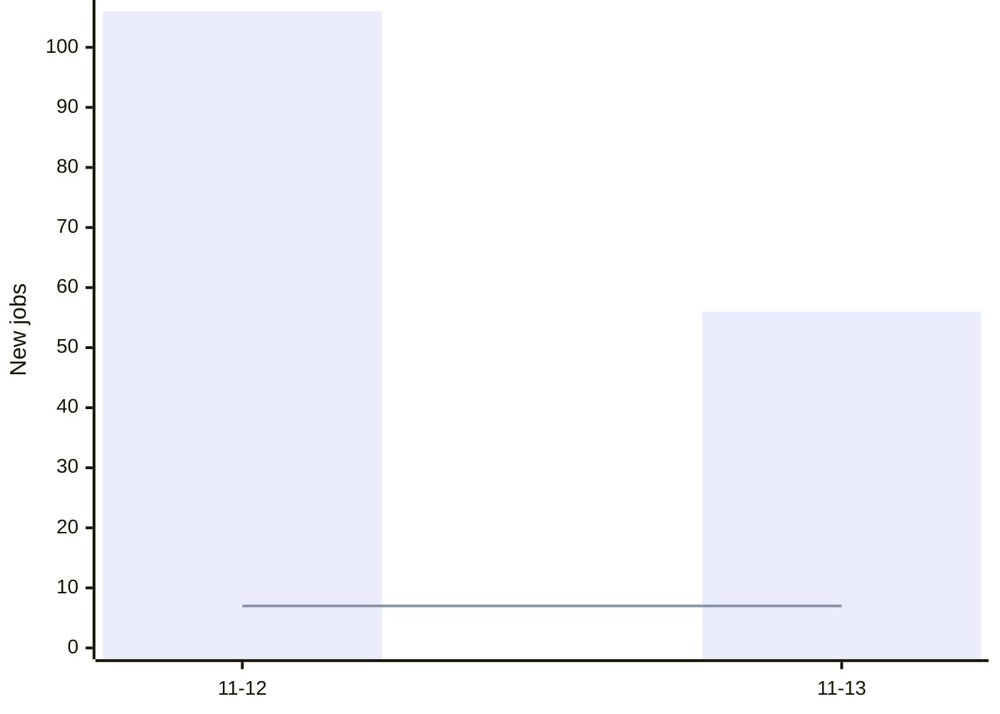

# Remote Software Job Tracker

Tracks remote **software development** jobs every day, sorts them by role (frontend, backend,
full-stack, mobile and more), and flags the ones open to candidates in Kenya. A GitHub Actions workflow runs a Python script on a schedule, fetches listings
from the [Remotive](https://remotive.com) and [Jobicy](https://jobicy.com) public APIs, deduplicates them, and commits the updated data.

**Live site:** https://mwangimark.github.io/frontend-job-tracker/ (Angular app in `site/`, redeployed after every update)

**Last updated:** 2026-11-13 · **Jobs tracked:** 162 · **Open to Kenya:** 14 ·
**New today:** 56 (7 open to Kenya)

**By role:** General Software: 35 · Data & AI: 28 · Solutions & Integrations: 18 · Backend: 16 · Engineering Leadership: 16 · Full-stack: 15 · Frontend: 9 · QA & Testing: 9 · DevOps & Cloud: 8 · Embedded & Systems: 5 · Mobile: 3

## New jobs per day (last 30 days)

Bars: all new jobs. Line: new jobs open to Kenya.

## Latest 20 jobs

| Published | Job | Role | Company | Location | Open to Kenya |
|---|---|---|---|---|---|
| 2026-11-13 | [OneStream Developer - Technical Lead (Philippines)](https://jobicy.com/jobs/161799-onestream-developer-technical-lead-philippines) | General Software | CrossCountry Consulting | Philippines |  |
| 2026-11-13 | [Coupa Technical Integration Consultant](https://jobicy.com/jobs/161788-coupa-technical-integration-consultant) | Solutions & Integrations | CrossCountry Consulting | Philippines |  |
| 2026-11-13 | [Front End Engineer](https://jobicy.com/jobs/161780-front-end-engineer) | Frontend | Oddball | USA |  |
| 2026-11-13 | [Sensing OPIR Engineer – SME #899](https://jobicy.com/jobs/161777-sensing-opir-engineer-sme-899) | General Software | Allen Integrated Solutions | USA |  |
| 2026-11-13 | [Sensing OPIR Engineer - Mid Level #900](https://jobicy.com/jobs/161776-sensing-opir-engineer-mid-level-900) | General Software | Allen Integrated Solutions | USA |  |
| 2026-11-13 | [Sensing OPIR Engineer - #898](https://jobicy.com/jobs/161774-sensing-opir-engineer-898) | General Software | Allen Integrated Solutions | USA |  |
| 2026-11-13 | [Sensing OPIR Engineer - #897](https://jobicy.com/jobs/161771-sensing-opir-engineer-897) | General Software | Allen Integrated Solutions | USA |  |
| 2026-11-13 | [Freelance Software Tester / Remote in Italy](https://jobicy.com/jobs/161767-freelance-software-tester-remote-in-italy) | QA & Testing | Testlio | Belgium,  Germany,  Italy |  |
| 2026-11-13 | [Senior Product Engineer](https://jobicy.com/jobs/161764-senior-product-engineer-2) | General Software | Fever | Spain |  |
| 2026-11-13 | [Andromeda Delta - Audio Transcription Adjudicator V2 - Spanish (Spain)](https://jobicy.com/jobs/161761-andromeda-delta-audio-transcription-adjudicator-v2-spanish-spain) | General Software | Welo Global | Spain |  |
| 2026-11-13 | [Freelance Software Tester / Remote in Germany](https://jobicy.com/jobs/161756-freelance-software-tester-remote-in-germany) | QA & Testing | Testlio | Belgium,  Germany,  Italy |  |
| 2026-11-13 | [Senior PHP/Wordpress Developer](https://jobicy.com/jobs/161754-senior-php-wordpress-developer) | Backend | Fever | Spain |  |
| 2026-11-13 | [Staff Forward Deployed Engineer, EMEA](https://jobicy.com/jobs/161753-staff-forward-deployed-engineer-emea) | Solutions & Integrations | GitLab | Austria,  France,  Germany,  Ireland,  Netherlands,  Spain,  UK |  |
| 2026-11-13 | [Freelance Software Tester / Remote in Belgium](https://jobicy.com/jobs/161742-freelance-software-tester-remote-in-belgium) | QA & Testing | Testlio | Belgium,  Germany,  Italy |  |
| 2026-11-13 | [Staff Backend Engineer, Performance Enablement](https://jobicy.com/jobs/161737-staff-backend-engineer-performance-enablement) | Backend | GitLab | Poland |  |
| 2026-11-13 | [Software Engineer, Systems Architecture](https://jobicy.com/jobs/161726-software-engineer-systems-architecture) | General Software | Valinor Enterprises, Inc. | USA |  |
| 2026-11-13 | [Software Engineer, Backend (Platform)](https://jobicy.com/jobs/161723-software-engineer-backend-platform) | DevOps & Cloud | Valinor Enterprises, Inc. | USA |  |
| 2026-11-13 | [Senior Software Engineer (Full Stack / Node.js & React / AI Focus)](https://jobicy.com/jobs/155233-senior-software-engineer-full-stack-node-js-react-ai-focus) | Full-stack | Oowlish Technology | Brazil |  |
| 2026-11-13 | [Full Stack Web Engineer](https://jobicy.com/jobs/155231-full-stack-web-engineer) | Full-stack | Fueled | LATAM |  |
| 2026-11-13 | [Junior Software Engineer – Early Career (Strong Problem solving & Coding Focus) - 100% Remote within Spain](https://jobicy.com/jobs/155228-junior-software-engineer-early-career-strong-problem-solving-coding-focus-100-remote-within-spain-2) | General Software | Docplanner | Spain |  |

## How it works

- `.github/workflows/track-jobs.yml` runs daily at 08:17 EAT (and on demand).
- `scripts/track_jobs.py` fetches the software development category, classifies each job's role from its title, merges new jobs into
  `data/jobs.csv`, appends a row to `data/daily_stats.csv`, and regenerates this README.
- Only Python's standard library is used, so the workflow needs no dependencies.
- `.github/workflows/deploy-site.yml` rebuilds the Angular site in `site/` with the new data
  and deploys it to GitHub Pages.

Job data comes from [Remotive](https://remotive.com) and [Jobicy](https://jobicy.com); each link goes to the original listing.
