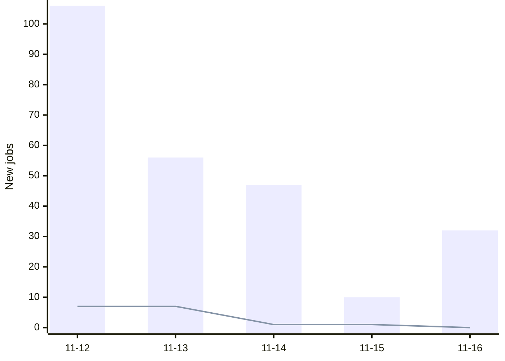

# Remote Software Job Tracker

Tracks remote **software development** jobs every day, sorts them by role (frontend, backend,
full-stack, mobile and more), and flags the ones open to candidates in Kenya. A GitHub Actions workflow runs a Python script on a schedule, fetches listings
from the [Remotive](https://remotive.com) and [Jobicy](https://jobicy.com) public APIs, deduplicates them, and commits the updated data.

**Live site:** https://mwangimark.github.io/frontend-job-tracker/ (Angular app in `site/`, redeployed after every update)

**Last updated:** 2026-11-16 · **Jobs tracked:** 251 · **Open to Kenya:** 16 ·
**New today:** 32 (0 open to Kenya)

**By role:** General Software: 59 · Data & AI: 38 · Full-stack: 28 · Solutions & Integrations: 28 · Engineering Leadership: 24 · Backend: 22 · Embedded & Systems: 13 · Frontend: 12 · DevOps & Cloud: 11 · QA & Testing: 11 · Mobile: 5

## New jobs per day (last 30 days)

Bars: all new jobs. Line: new jobs open to Kenya.

## Latest 20 jobs

| Published | Job | Role | Company | Location | Open to Kenya |
|---|---|---|---|---|---|
| 2026-11-16 | [Principal Software Engineer - Observability & Telemetry Data](https://jobicy.com/jobs/162553-principal-software-engineer-observability-telemetry-data) | Data & AI | Smartsheet | USA |  |
| 2026-11-16 | [NetSuite Developer](https://jobicy.com/jobs/162552-netsuite-developer) | General Software | Cologix, Inc. | USA |  |
| 2026-11-16 | [Safety Analysis Engineer](https://jobicy.com/jobs/162537-safety-analysis-engineer) | General Software | Oklo Inc. | USA |  |
| 2026-11-16 | [Senior Software Engineer, Services](https://jobicy.com/jobs/162522-senior-software-engineer-services) | General Software | Rush Street Interactive | Canada |  |
| 2026-11-16 | [Backend Engineer (Python),AI Engineering: Agent Foundations](https://jobicy.com/jobs/155430-backend-engineer-pythonai-engineering-agent-foundations) | Data & AI | GitLab | Canada,  Poland,  UK |  |
| 2026-11-16 | [Senior Backend Engineer (Boosters)](https://jobicy.com/jobs/153227-senior-backend-engineer-boosters) | Backend | Playson | Europe |  |
| 2026-11-16 | [Senior+ Backend Software Engineer - Asia](https://jobicy.com/jobs/153195-senior-backend-software-engineer-asia) | Backend | Palmstreet | China |  |
| 2026-11-16 | [Senior Software Engineer (Game Engine)](https://jobicy.com/jobs/146058-senior-software-engineer-game-engine) | General Software | Playson | Europe |  |
| 2026-11-16 | [Ubuntu Linux Kernel Test Engineer](https://jobicy.com/jobs/145995-ubuntu-linux-kernel-test-engineer) | Embedded & Systems | Canonical | APAC,  China |  |
| 2026-11-16 | [Member of Technical Staff (Robotics)](https://jobicy.com/jobs/153241-member-of-technical-staff-robotics) | General Software | Reka | UK |  |
| 2026-11-16 | [Senior+ Backend Software Engineer - Canada](https://jobicy.com/jobs/153205-senior-backend-software-engineer-canada) | Backend | Palmstreet | Canada |  |
| 2026-11-16 | [Senior Integrations Engineer](https://jobicy.com/jobs/149161-senior-integrations-engineer) | Solutions & Integrations | NTT DATA | LATAM |  |
| 2026-11-16 | [Senior Software Engineer, Backend - Platform Team](https://jobicy.com/jobs/146081-senior-software-engineer-backend-platform-team) | DevOps & Cloud | Cresta | Canada,  USA |  |
| 2026-11-15 | [Staff Developer Advocate, Enterprise - EMEA](https://jobicy.com/jobs/162481-staff-developer-advocate-enterprise-emea) | Solutions & Integrations | Temporal Technologies | Germany |  |
| 2026-11-15 | [Senior Full Stack Engineer / Experimentation - Product Analytics / UK / Remote](https://jobicy.com/jobs/162450-senior-full-stack-engineer-experimentation-product-analytics-uk-remote) | Full-stack | Grafana Labs | Germany,  Ireland,  Spain,  Sweden,  UK |  |
| 2026-11-15 | [Senior Full Stack Engineer / Experimentation - Product Analytics / Sweden / Remote](https://jobicy.com/jobs/162448-senior-full-stack-engineer-experimentation-product-analytics-sweden-remote) | Full-stack | Grafana Labs | Germany,  Ireland,  Spain,  Sweden,  UK |  |
| 2026-11-15 | [Senior Full Stack Engineer / Experimentation - Product Analytics / Spain / Remote](https://jobicy.com/jobs/162446-senior-full-stack-engineer-experimentation-product-analytics-spain-remote) | Full-stack | Grafana Labs | Germany,  Ireland,  Spain,  Sweden,  UK |  |
| 2026-11-15 | [Senior Full Stack Engineer / Experimentation - Product Analytics / Ireland / Remote](https://jobicy.com/jobs/162444-senior-full-stack-engineer-experimentation-product-analytics-ireland-remote) | Full-stack | Grafana Labs | Germany,  Ireland,  Spain,  Sweden,  UK |  |
| 2026-11-15 | [Senior Full Stack Engineer / Experimentation - Product Analytics / Germany / Remote](https://jobicy.com/jobs/162442-senior-full-stack-engineer-experimentation-product-analytics-germany-remote) | Full-stack | Grafana Labs | Germany,  Ireland,  Spain,  Sweden,  UK |  |
| 2026-11-15 | [Web Automation Test Engineer](https://jobicy.com/jobs/162439-web-automation-test-engineer-2) | QA & Testing | Caylent | Brazil |  |

## How it works

- `.github/workflows/track-jobs.yml` runs daily at 08:17 EAT (and on demand).
- `scripts/track_jobs.py` fetches the software development category, classifies each job's role from its title, merges new jobs into
  `data/jobs.csv`, appends a row to `data/daily_stats.csv`, and regenerates this README.
- Only Python's standard library is used, so the workflow needs no dependencies.
- `.github/workflows/deploy-site.yml` rebuilds the Angular site in `site/` with the new data
  and deploys it to GitHub Pages.
- `scripts/send_alerts.py` emails subscribers their matching new jobs (daily, or weekly on Mondays).
  Subscribers are stored in Supabase (`supabase/schema.sql`); emails go out through Gmail SMTP.

Job data comes from [Remotive](https://remotive.com) and [Jobicy](https://jobicy.com); each link goes to the original listing.
