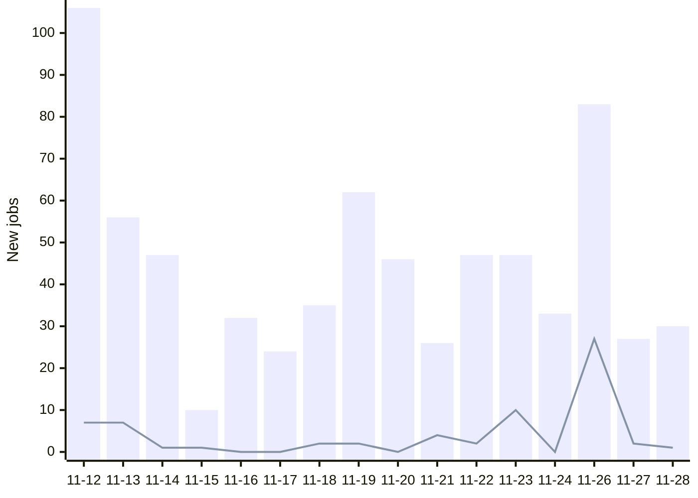

# Remote Software Job Tracker

Tracks remote **software development** jobs every day, sorts them by role (frontend, backend,
full-stack, mobile and more), and flags the ones open to candidates in Kenya. A GitHub Actions workflow runs a Python script on a schedule, fetches listings
from the [Remotive](https://remotive.com) and [Jobicy](https://jobicy.com) public APIs, deduplicates them, and commits the updated data.

**Live site:** https://mwangimark.github.io/frontend-job-tracker/ (Angular app in `site/`, redeployed after every update)

**Last updated:** 2026-11-28 · **Jobs tracked:** 711 · **Open to Kenya:** 66 ·
**New today:** 30 (1 open to Kenya)

**By role:** General Software: 220 · Data & AI: 87 · Engineering Leadership: 65 · Full-stack: 62 · Solutions & Integrations: 59 · Backend: 57 · QA & Testing: 52 · Mobile: 32 · DevOps & Cloud: 28 · Frontend: 26 · Embedded & Systems: 23

## New jobs per day (last 30 days)

Bars: all new jobs. Line: new jobs open to Kenya.

## Latest 20 jobs

| Published | Job | Role | Company | Location | Open to Kenya |
|---|---|---|---|---|---|
| 2026-11-28 | [Senior Engineering Manager, Grafana Frontend / United Kingdom / Remote](https://jobicy.com/jobs/157684-senior-engineering-manager-grafana-frontend-united-kingdom-remote) | Engineering Leadership | Grafana Labs | UK |  |
| 2026-11-28 | [Senior Engineering Manager, Grafana Frontend / Sweden / Remote](https://jobicy.com/jobs/157681-senior-engineering-manager-grafana-frontend-sweden-remote) | Engineering Leadership | Grafana Labs | Sweden |  |
| 2026-11-28 | [Principal Software Architect](https://jobicy.com/jobs/157679-principal-software-architect-2) | General Software | Testlio | EMEA,  USA | ✅ |
| 2026-11-28 | [Senior Engineering Manager, Grafana Frontend / Spain / Remote](https://jobicy.com/jobs/157676-senior-engineering-manager-grafana-frontend-spain-remote) | Engineering Leadership | Grafana Labs | Spain |  |
| 2026-11-28 | [Senior Engineering Manager, Grafana Frontend / Ireland / Remote](https://jobicy.com/jobs/157670-senior-engineering-manager-grafana-frontend-ireland-remote) | Engineering Leadership | Grafana Labs | Europe |  |
| 2026-11-28 | [Senior Software Engineer - Search Infrastructure](https://jobicy.com/jobs/157669-senior-software-engineer-search-infrastructure) | DevOps & Cloud | Algolia | France |  |
| 2026-11-28 | [Senior Software Engineer, Containers](https://jobicy.com/jobs/157668-senior-software-engineer-containers) | General Software | Chainguard | Canada,  Germany,  UK,  USA |  |
| 2026-11-28 | [Staff Software Engineer, Machine Learning (Consumer Revenue)](https://jobicy.com/jobs/157641-staff-software-engineer-machine-learning-consumer-revenue) | Data & AI | Discord | USA |  |
| 2026-11-28 | [Senior Software Engineer, Data Platform](https://jobicy.com/jobs/157521-senior-software-engineer-data-platform) | DevOps & Cloud | Algolia | France |  |
| 2026-11-28 | [Staff Software Engineer](https://jobicy.com/jobs/157607-staff-software-engineer-13) | General Software | Juniper Square | Canada,  USA |  |
| 2026-11-28 | [Growth Engineer](https://jobicy.com/jobs/157601-growth-engineer) | General Software | Cresta | USA |  |
| 2026-11-28 | [Systems Architect](https://jobicy.com/jobs/157599-systems-architect) | General Software | Elevenlabs | USA |  |
| 2026-11-28 | [Machine Learning Engineer, Core Engineering](https://jobicy.com/jobs/157491-machine-learning-engineer-core-engineering) | Data & AI | Pinterest | USA |  |
| 2026-11-28 | [ChatGPT Performance Engineer](https://jobicy.com/jobs/151770-chatgpt-performance-engineer) | General Software | OpenAI | USA |  |
| 2026-11-28 | [Full-Stack Engineer (Frontend Leaning) - Studio](https://jobicy.com/jobs/157529-full-stack-engineer-frontend-leaning-studio) | Full-stack | Elevenlabs | Bulgaria,  Poland,  UK,  USA |  |
| 2026-11-28 | [Senior Backend Software Engineer](https://jobicy.com/jobs/157489-senior-backend-software-engineer) | Backend | Headway.co | USA |  |
| 2026-11-28 | [Senior iOS Engineer](https://jobicy.com/jobs/157488-senior-ios-engineer-4) | Mobile | ŌURA | USA |  |
| 2026-11-28 | [Senior Fullstack Software Engineer](https://jobicy.com/jobs/157485-senior-fullstack-software-engineer) | Full-stack | Headway.co | USA |  |
| 2026-11-28 | [Senior Business Systems Engineer](https://jobicy.com/jobs/157472-senior-business-systems-engineer) | Solutions & Integrations | ŌURA | USA |  |
| 2026-11-28 | [Staff Backend Engineer](https://jobicy.com/jobs/151706-staff-backend-engineer) | Backend | Future PLC | USA |  |

## How it works

- `.github/workflows/track-jobs.yml` runs daily at 08:17 EAT (and on demand).
- `scripts/track_jobs.py` fetches the software development category, classifies each job's role from its title, merges new jobs into
  `data/jobs.csv`, appends a row to `data/daily_stats.csv`, and regenerates this README.
- Only Python's standard library is used, so the workflow needs no dependencies.
- `.github/workflows/deploy-site.yml` rebuilds the Angular site in `site/` with the new data
  and deploys it to GitHub Pages.
- `scripts/send_alerts.py` emails subscribers their matching new jobs (daily, or weekly on Mondays).
  Subscribers are stored in Supabase (`supabase/schema.sql`); emails go out through Gmail SMTP.

Job data comes from [Remotive](https://remotive.com) and [Jobicy](https://jobicy.com); each link goes to the original listing.
