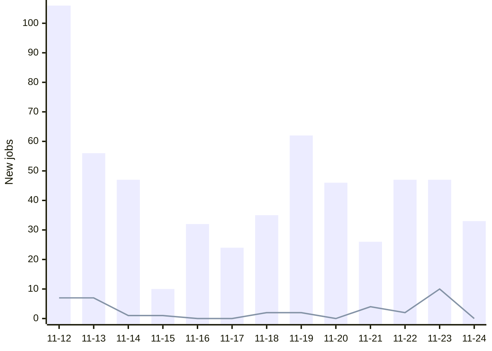

# Remote Software Job Tracker

Tracks remote **software development** jobs every day, sorts them by role (frontend, backend,
full-stack, mobile and more), and flags the ones open to candidates in Kenya. A GitHub Actions workflow runs a Python script on a schedule, fetches listings
from the [Remotive](https://remotive.com) and [Jobicy](https://jobicy.com) public APIs, deduplicates them, and commits the updated data.

**Live site:** https://mwangimark.github.io/frontend-job-tracker/ (Angular app in `site/`, redeployed after every update)

**Last updated:** 2026-11-24 · **Jobs tracked:** 571 · **Open to Kenya:** 36 ·
**New today:** 33 (0 open to Kenya)

**By role:** General Software: 160 · Data & AI: 74 · Solutions & Integrations: 54 · Full-stack: 52 · Engineering Leadership: 50 · Backend: 48 · QA & Testing: 45 · Mobile: 28 · DevOps & Cloud: 22 · Frontend: 22 · Embedded & Systems: 16

## New jobs per day (last 30 days)

Bars: all new jobs. Line: new jobs open to Kenya.

## Latest 20 jobs

| Published | Job | Role | Company | Location | Open to Kenya |
|---|---|---|---|---|---|
| 2026-11-24 | [Tech Lead - Video Templates](https://jobicy.com/jobs/164092-tech-lead-video-templates-2) | General Software | Envato | Mexico |  |
| 2026-11-24 | [Product Engineer](https://jobicy.com/jobs/164080-product-engineer-3) | General Software | GovSignals | USA |  |
| 2026-11-24 | [Software Tester (Freelance) / Test AT&T U-verse & Cox](https://jobicy.com/jobs/164073-software-tester-freelance-test-att-u-verse-cox) | QA & Testing | Testlio | USA |  |
| 2026-11-24 | [Freelance Product Tester (Remote) / Test AT&T U-verse & Cox](https://jobicy.com/jobs/164067-freelance-product-tester-remote-test-att-u-verse-cox) | QA & Testing | Testlio | USA |  |
| 2026-11-24 | [Engineering Manager, Experimentation](https://jobicy.com/jobs/164055-engineering-manager-experimentation-2) | Engineering Leadership | LaunchDarkly | USA |  |
| 2026-11-24 | [Senior Software Engineer](https://jobicy.com/jobs/164038-senior-software-engineer-30) | General Software | Veriff | Spain |  |
| 2026-11-24 | [Semi Sr. - QA Engineer (Data) – E-Learning](https://jobicy.com/jobs/164036-semi-sr-qa-engineer-data-e-learning) | Data & AI | Truelogic | Brazil |  |
| 2026-11-24 | [Jr. Semi Sr. - QA Engineer (Data) – E-Learning](https://jobicy.com/jobs/164032-jr-semi-sr-qa-engineer-data-e-learning) | Data & AI | Truelogic | Brazil |  |
| 2026-11-24 | [Scout Junior Quality Coordinator - Portuguese (Brazil)](https://jobicy.com/jobs/151333-scout-junior-quality-coordinator-portuguese-brazil) | QA & Testing | Welo Global | Brazil |  |
| 2026-11-24 | [Senior Software Engineer (Fundraising) — Remote](https://jobicy.com/jobs/156858-senior-software-engineer-fundraising-remote) | General Software | GiveDirectly | Canada,  UK,  USA |  |
| 2026-11-24 | [Senior Engineering Manager](https://jobicy.com/jobs/156848-senior-engineering-manager-2) | Engineering Leadership | Monzo | UK |  |
| 2026-11-24 | [AI Agent Engineer](https://jobicy.com/jobs/156835-ai-agent-engineer) | Data & AI | Binance | Hong Kong,  Singapore |  |
| 2026-11-24 | [Software Engineer](https://jobicy.com/jobs/156829-software-engineer-13) | General Software | PolicyMe | Canada |  |
| 2026-11-24 | [Principal Software Engineer, SIEM (Ruby/Rails)](https://jobicy.com/jobs/156769-principal-software-engineer-siem-ruby-rails) | Backend | Huntress | USA |  |
| 2026-11-24 | [Principal Software Engineer - Agentic SOC](https://jobicy.com/jobs/156767-principal-software-engineer-agentic-soc) | General Software | Huntress | USA |  |
| 2026-11-24 | [Staff Backend Engineer](https://jobicy.com/jobs/153889-staff-backend-engineer-3) | Backend | Socure | USA |  |
| 2026-11-24 | [Chief Technology Officer - US-Based](https://jobicy.com/jobs/153888-chief-technology-officer-us-based) | General Software | Toptal | USA |  |
| 2026-11-24 | [Senior Manager, Solution Engineering - DocV](https://jobicy.com/jobs/153882-senior-manager-solution-engineering-docv) | General Software | Socure | USA |  |
| 2026-11-24 | [Full Stack Engineer](https://jobicy.com/jobs/151415-full-stack-engineer) | Full-stack | Roboflow | USA |  |
| 2026-11-24 | [Developer Advocate](https://jobicy.com/jobs/151412-developer-advocate) | Solutions & Integrations | Roboflow | USA |  |

## How it works

- `.github/workflows/track-jobs.yml` runs daily at 08:17 EAT (and on demand).
- `scripts/track_jobs.py` fetches the software development category, classifies each job's role from its title, merges new jobs into
  `data/jobs.csv`, appends a row to `data/daily_stats.csv`, and regenerates this README.
- Only Python's standard library is used, so the workflow needs no dependencies.
- `.github/workflows/deploy-site.yml` rebuilds the Angular site in `site/` with the new data
  and deploys it to GitHub Pages.
- `scripts/send_alerts.py` emails subscribers their matching new jobs (daily, or weekly on Mondays).
  Subscribers are stored in Supabase (`supabase/schema.sql`); emails go out through Gmail SMTP.

Job data comes from [Remotive](https://remotive.com) and [Jobicy](https://jobicy.com); each link goes to the original listing.
